# MAGA 检索评测：通俗版说明 + 技术附录（2026-11-27）

> 这份文档先回答“三种检索方案到底差在哪、图怎么看、结果说明什么”，最后再放公式、置信区间和复现命令。
> 所有数字来自真实运行：DeepSeek `deepseek-flash` + Jina `jina-embeddings-v3`，36 条人工标注 Query，340 张页图 + 82 个 OCR 文本。

---

## 0. 先看 5 句话

1. **混合检索（hybrid）明显最好。** 36 道题的平均排序分从 **0.275 提高到 0.565**；中文题从 **0.025 提高到 0.428**。
2. **“先翻译再搜”有用，但不够。** 只翻译能把中文题从 0.025 提到 0.189；hybrid 再靠“按意思找”提到 0.428。
3. **“AI 增强检索”不值得当默认。** 它和标准检索几乎一样（−0.004），却慢约 **21 倍**，还有 6/36 次退回普通搜索。
4. **OCR 不是免费加分。** 给 82 个稀疏页加 OCR 后，标准检索反而从 0.340 降到 0.275；因为 OCR 会把 logo、页码、图注也读进来，干扰排序。
5. **hybrid 很慢。** 95% 的请求要 3.7 秒，标准检索只要 0.17 秒。所以它适合“中文长问题、愿意等”的场景，不适合直接变成所有人的默认。

---

## 1. 三种检索方案：用一个真实问题看懂

### 1.1 题目

假设学生在架构实践里问：

> **“热门活动三千人同时报名，怎么保证名额不超卖？”**

课程 PPT 是英文的，相关页可能在讲并发、事务、唯一约束、可用性战术。问题是：**系统怎么从 340 页里挑出 8 页交给 AI？**

### 1.2 三种方案分别怎么做

| 方案 | 一句话 | 实际做了什么 | 容易在哪里翻车 | 实测平均分（约束型 9 题） | 典型耗时 |
|---|---|---|---:|---:|---:|
| 标准检索 baseline | 按字面词找书 | 用关键词 + 12 组中英同义词 + 中文双字匹配，扫所有页 | 中文口语里没有“报名/名额”这些原词，就找不到英文页 | **0.020** | 0.14 s |
| AI 增强 llm_assisted | 先让助手列几个关键词，再按字面找 | 先请 LLM 写 1–3 条检索词，再逐条关键词搜索、合并 | 写出来的词仍可能不是课件原词；多一次 LLM 调用；失败会退回 baseline | 0.032 | 3.0 s |
| 翻译+词法（消融） | 先把中文翻成英文，再按字面找 | 用 LLM 把问题翻成英文，再走关键词搜索 | 翻译可能丢掉“coupling”“rollback”这类术语 | 0.107 | 1.5 s |
| **混合检索 hybrid** | 翻成英文后，既看关键词也看“意思像不像” | 英文 Query → BM25 关键词分 + Jina 向量语义分（0.5×语义 + 0.2×关键词）→ 取前 8 页 | 需要 Jina、索引和网络；更慢；索引没建好会直接报错 | **0.560** | 2.6 s |

> 生活化类比：
> - baseline 像“按书名里的关键词找书”；
> - llm_assisted 像“先让助手写几个关键词，再按关键词找书”；
> - 翻译+词法 像“先把中文问题翻成英文，再按关键词找书”；
> - hybrid 像“翻成英文后，既看关键词，也看哪一页在讲同一个意思”。

### 1.3 同一个问题，实际分数差多少

下面这些是**单条 Query** 的 nDCG@8（0–1，越高越好），不是平均值：

| Query | baseline | llm_assisted | hybrid | 翻译+词法 | 人话解释 |
|---|---:|---:|---:|---:|---|
| `heartbeat-zh`「怎么检测一个服务是不是还活着」 | 0.000 | 0.000 | **0.884** | 0.263 | 中文口语里没有“心跳”二字；baseline/增强都找不到，翻译+词法找到一点，hybrid 找到心跳页 |
| `recovery-constraint`「数据库写失败…重试还是回滚」 | 0.000 | 0.000 | **0.745** | 0.457 | 同样没有原词；hybrid 靠语义找到恢复战术页 |
| `coupling-constraint`「两个模块有相似功能，怎么抽象」 | 0.126 | 0.206 | **0.594** | 0.000 | 翻译把 `coupling/abstract common services` 丢了；hybrid 靠语义补回来 |
| `service-discovery-mixed` | 0.000 | 0.000 | **0.751** | 0.567 | 中英混合问法；hybrid 同时利用英文术语和语义 |

### 1.4 为什么 hybrid 更好，但又不建议当默认

- **更好**：它不只认字面词，还能把“服务还活着”跟“heartbeat / fault detection”这类**意思相近但字不同**的页连起来。中文题和约束型题收益最大。
- **不建议默认**：每次中文问题都要先翻译再算向量，95% 的请求约 3.7 秒；标准检索只要 0.17 秒。演示时等 3–4 秒可以接受，所有人默认用就会明显变慢。
- **还会失败**：实测 hybrid 实践出现过 502（AI 返回内容无法识别），重试后成功；索引没就绪时也会明确报错。它不是一个“永远成功”的黑盒。

---

## 2. 数据集为什么这样设计

### 2.1 9 个概念 × 4 种问法 = 36 条

选的是课程里最核心的 9 个概念：heartbeat、availability、recovery、interoperability、service discovery、modifiability、coupling/cohesion、performance tactics、scheduling。

每个概念都问 4 遍，以 heartbeat 为例：

| 问法 | 实际 Query | 想测什么 |
|---|---|---|
| 英文术语 | `heartbeat` | 只给术语，看能不能找到定义页 |
| 中文自然语言 | 怎么检测一个服务是不是还活着 | 学生不会说术语时，还能不能找到 |
| 中英混合 | 服务存活检测 heartbeat 周期性消息 | 半懂不懂、中英夹杂的真实问法 |
| 约束型 | 监控进程每隔几秒向被监控进程发消息，超时后判定它故障，这属于什么战术 | 只描述场景，不出现“心跳”二字 |

### 2.2 为什么不能只测一种问法

- **只测英文术语**：baseline 很可能赢，因为它就认这个词。但这不代表学生真实提问时好用。
- **只测中文自然语言**：baseline 会惨败，看起来 hybrid 无敌；但你无法知道“英文术语题有没有被牺牲”。
- **四种问法放在一起**：才能看出“同一个知识点，换一种说法会不会失效”，也才能避免数据集本身偏向某个方案。

### 2.3 “标准答案页”和 0/1/2 分

- 对每条 Query，人工在 340 页里圈出“应该被找到的页”，相当于老师批改用的**标准答案**。
- `2` = 这页直接定义/解释了这个概念；`1` = 例子、场景、总结或密切相关的战术；没圈到的页按 0 计。
- 同一概念的 4 种问法**共用同一组标准答案页**：因为它们问的是同一个知识点，只是说法不同。
- 本轮只有**一位标注者**，没有第二人盲审，也没有算标注者一致性（κ）。这是结论的主要局限之一。

### 2.4 36 条会不会太少

会限制结论的“普适性”，但不影响“同一批题上谁更好”的配对比较：

- 每条 Query 都在完全相同的条件下跑所有方案，比较的是**同题差值**，不是拿不同题的平均分硬拼。
- 每类只有 9 条，置信区间很宽；所以文档里所有“更好/更差”都带 95% CI，跨 0 就写“未证明”。
- 结论只适用于“本课程、本夹具、本模型版本”，不能外推成通用搜索引擎排名。

---

## 3. 参数小抄（看到缩写就查这里）

| 名词 | 人话解释 | 怎么读 |
|---|---|---|
| **nDCG@8** | 排序质量分，0–1，越高越好；@8 表示只看前 8 个来源 | 把“必看页”排得越靠前分越高；第 1 名命中比第 8 名命中值钱得多。0.565 不是“56.5% 准确率” |
| **Recall@5** | 前 5 个结果覆盖了多少“必看页” | 标准答案有 4 页，前 5 名找到 2 页，就是 0.5；越高越好 |
| **MRR** | 第一个正确页排第几的倒数 | 第 1 名=1，第 2 名=0.5，第 5 名=0.2；越高越好 |
| **Hit@5** | 前 5 个里有没有至少一个正确页 | 有=1，没有=0；最粗的“有没有找到” |
| **p50 / p95** | 一半 / 95% 的请求要等多久 | 越小越快；p95 更能代表“慢的时候有多慢” |
| **95% CI** | 换一批类似题，分数可能波动的范围 | 例如 `+0.290 [0.195, 0.394]`：大概率在 0.195–0.394 之间；如果区间跨 0，就不能确定谁更好 |
| **fallback（回退）** | AI 查询规划失败，退回普通关键词搜索 | 回退次数越多，说明“AI 增强”越不稳定 |
| **L1 / L2** | L1=同一道英文题，只换检索器；L2=用户真实中文提问 | L1 看“算法本身”；L2 看“真实使用” |
| **K=8 / K=10** | 只看前 8 / 前 10 个来源 | 应用最多喂给模型 8 页；L1 用 10 页做诊断 |
| **OCR** | 把图片里的文字识别出来 | 只补文字，不理解箭头/布局；识别错误和噪声会干扰搜索 |
| **消融（ablation）** | 故意拆掉一个部件，看它贡献多少 | `translated_lexical` 只保留翻译、去掉向量，用来看“嵌入到底有没有用” |

---

## 4. 图表怎么读

### 4.1 读图三步

1. **看横轴**：是“英文术语 / 中文自然语言 / 中英混合 / 约束型 / 全部”中的哪一类。
2. **看纵轴**：nDCG/Recall 是 0–1，越高越好；延迟是毫秒，越低越好；差值图以 0 为中线。
3. **看颜色**：同一种颜色代表同一种方案；同一组里比高低，不要跨不同图硬比。

### 4.2 每张图代表什么

**图 1：L1 检索器 nDCG@10**（同一批英文问题，只换检索器）

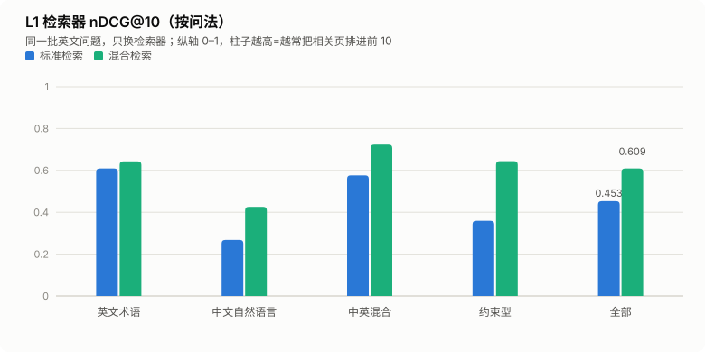

- 横轴：4 种问法 + 全部；纵轴：排序质量 0–1。
- 蓝色=标准检索，绿色=混合检索；柱子越高越好。
- 一句话：即使都给英文 Query，hybrid 在中文、混合、约束型上仍更高；英文术语只小幅领先。

**图 2：L2 产品链路 nDCG@8**（真实使用：用户原话直接进系统）

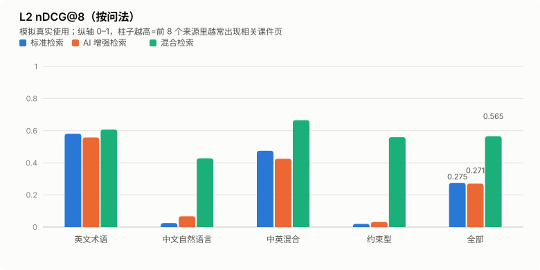

- 横轴：问法；纵轴：排序质量 0–1。
- 蓝=标准，橙=AI 增强，绿=混合；柱子越高越好。
- 一句话：中文/约束型上，标准检索几乎贴地，hybrid 明显抬起；英文术语三者差不多。

**图 3：L2 Recall@5**（前 5 个结果覆盖了多少必看页）

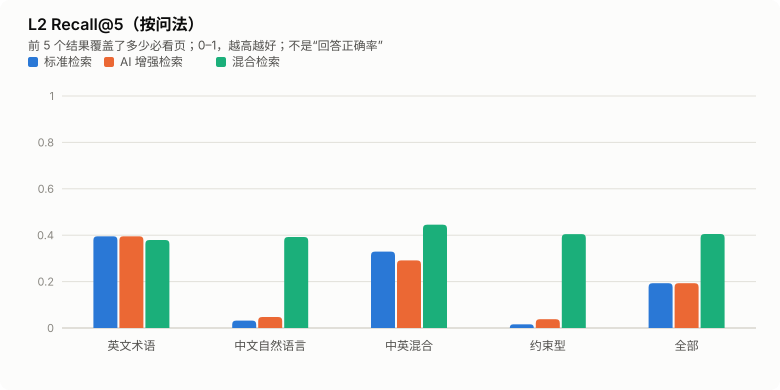

- 纵轴 0–1，越高表示“该看的页被前 5 名覆盖得越多”。
- 一句话：hybrid 在中文和约束型上覆盖更全；英文术语差距小。

**图 4：混合检索相对标准检索的差值**

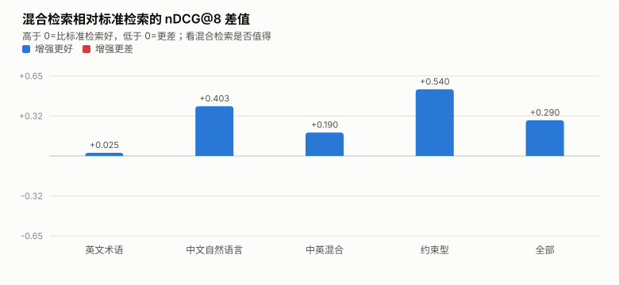

- 横轴：问法；纵轴：`hybrid − baseline` 的 nDCG 差值。
- **柱子高于 0 = hybrid 更好；低于 0 = 更差**。
- 一句话：中文 +0.403、约束型 +0.540，英文 +0.025（基本打平）。

**图 5：AI 增强相对标准检索的差值**

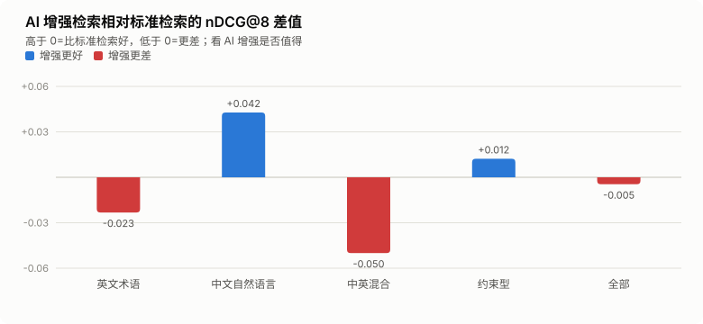

- 高于 0 = 增强更好，低于 0 = 更差。
- 一句话：中文略正、中英混合为负、总体接近 0；花了 21 倍时间却没有稳定收益。

**图 6：L2 检索延迟**

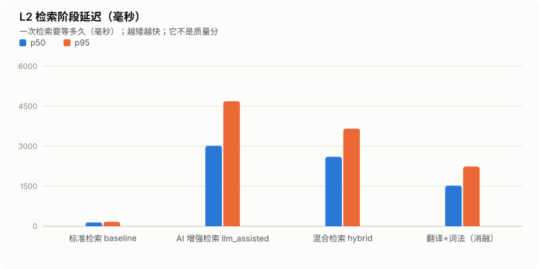

- 纵轴：毫秒；每个方案有 p50（一半请求）和 p95（慢的时候）。
- **柱子越矮越快**；延迟不是质量分。
- 一句话：baseline 0.14 s，hybrid 2.6 s（p95 3.7 s），llm 3.0 s（p95 4.7 s）。

**图 7：翻译消融**

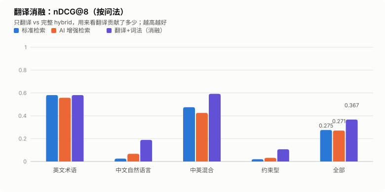

- 蓝=标准，橙=AI 增强，紫=翻译+词法（只翻译、不加向量）。
- 一句话：翻译能救回一部分中文题（0.025→0.189），但完整 hybrid 还能再靠语义提到 0.428；翻译不是全部。

**表：OCR 前后对比**（不是图，但读法一样）

- 数值是“开 OCR 后 − 开 OCR 前”；**负数=开 OCR 后更差**。
- 一句话：标准检索 −0.064、hybrid 约束型 −0.108；OCR 在这套文本题上引入了噪声。

---

## 5. 结果说明什么

### 5.1 五条人话结论

1. **hybrid 在中文和约束型问题上明显更好。**
   - 中文自然语言：0.025 → 0.428；约束型：0.020 → 0.560。
   - 具体例子：`heartbeat-zh` 从 0.000 到 0.884；`recovery-constraint` 从 0.000 到 0.745。
2. **翻译是必要一步，但不是全部。**
   - 只翻译：中文 0.189；完整 hybrid：0.428。
   - 具体例子：`coupling-constraint` 翻译后反而 0.000，hybrid 0.594——因为翻译丢了术语，向量语义补回来。
3. **AI 增强检索不值得默认。**
   - 总体 −0.004（CI 跨 0），中英混合 −0.050；p50 3.0 s，约为 baseline 的 21 倍；6/36 次回退。
   - 它适合作为“对照/研究模式”，不适合让所有用户默认多等 3 秒。
4. **OCR 不是免费加分。**
   - 82 个稀疏页加 OCR 后，标准检索 −0.064（有证据更差），hybrid 约束型 −0.108。
   - 原因：OCR 会把 logo、页码、图注、图表里的零散词读进来，关键词排序被噪声干扰；这套题的相关页又主要是文字页，OCR 帮不上忙。
   - **这不等于 OCR 没用**：如果问题是“纯图片页讲了什么”，OCR 可能是唯一文字来源。但本夹具没有图片页标准答案，无法证明收益。
5. **质量提升是用时间换的。**
   - hybrid p95 约 3.7 s，baseline 0.17 s。
   - 所以建议：默认 baseline；中文长描述/约束型问题显式推荐 hybrid，并提示“会多等 2–3 秒”。

### 5.2 这次评测能说明什么 / 不能说明什么

| 能说明 | 不能说明 |
|---|---|
| 在本课程 36 条题、本模型版本下，hybrid 的排序明显好于 baseline | 不能说明 hybrid 在所有课程/所有模型上都更好 |
| 中文自然语言和约束型是 baseline 的主要短板 | 不能说明“中文一定比英文难”；只说明这套夹具里的中文口语缺原词 |
| `llm_assisted` 没有稳定收益，且明显更慢 | 不能说明所有“AI 改写查询”都没用；只说明当前实现/模型下不划算 |
| OCR 在这套文本题上拉低了指标 | 不能说明 OCR 对图片页没用；图片页收益未被测试 |
| 延迟/回退/失败路径可量化、可复现 | 不能说明生产环境的 SLA、并发能力、费用 |

### 5.3 给产品的建议

1. **默认保持 baseline**：最快、最稳、英文术语题不差。
2. **hybrid 做成显式高质量选项**：中文长描述、约束型问题推荐使用；界面提示延迟。
3. **`llm_assisted` 不设为默认**：保留为对照/研究模式。
4. **OCR 先不默认开启**：先补 image-only 标注子集，确认 OCR 噪声和收益的边界。
5. **补第二标注者**（至少 20% 盲审），每类扩到 ≥30 条后再做最终架构决策。
6. **教学评测独立做**：3 案例 × 3 目标 × 3 档答案 = 27 份，两人盲评 + κ；本次截图只证明流程可用。

---

## 6. 一场架构实践到底检索几次 PPT

### 7.1 完整流程

| 阶段 | 后端做了什么 | 是否检索 PPT | 产出 |
|---|---|---|---|
| 1. 选案例/选策略 | 前端锁定 `baseline` / `llm_assisted` / `hybrid` | 否 | 整场使用同一种策略 |
| 2. 出题 `POST /api/practice/plan` | LLM 写 1–3 条英文 Query → 按策略检索 → 取前 8 页 → 教学 LLM 出题 | **是，1 次** | 3 个决策问题 + 每题引用 |
| 3. 第 1 个决策首次回答 `POST /api/practice/answer` | 根据案例/问题/学生回答再写 Query → 检索 → 教学 LLM 同时评价并决定是否追问 | **是，1 次/轮回答** | 反馈 + 可能 1 个追问 |
| 4. 追问回答 | 带上前几轮对话再检索 | **是，1 次/轮回答** | 反馈 + 可能再追问（最多 2 次） |
| 5. 第 2、3 个决策 | 重复 3–4 | **每个决策 1–3 次** | 逐点完成 |
| 6. 综合评审 `POST /api/practice/finalize` | 汇总 3 个决策的首次回答、追问、完成状态 → 再检索 → 生成总结/优点/改进/参考思路 | **是，1 次** | 综合评审 + 引用 |

**关键点：**

- **“评价回答”和“决定要不要追问”是同一次检索、同一次 LLM 调用完成的**，不是先检索评价、再检索追问。
- 出题阶段的 3 个问题是同一次检索后一起生成的，不是 3 次检索。
- 每次学生提交回答，都会基于当前回答和历史重新检索一次。
- 综合评审会重新检索，不复用出题时的 8 页。
- 策略一旦开始实践就锁定（`web/src/PracticeStudio.tsx:171`），整场不换。

### 7.2 一共检索几次

设 3 个决策点一共产生 `A` 次学生回答（每个决策 1–3 轮，所以 `A = 3 ~ 9`）：

```text
RAG 阶段数 = 出题 1 次 + 回答 A 次 + 综合评审 1 次 = A + 2 = 5 ~ 11 次
```

| 情况 | 回答轮数 A | RAG 阶段数 |
|---|---:|---:|
| 每个决策都一次答完，不触发追问 | 3 | **5 次** |
| 每个决策各追问 1 次（最常见） | 6 | **8 次** |
| 每个决策都追问满 2 次 | 9 | **11 次** |

每次 RAG 阶段内部，按策略发出 **1–3 条 Query**：

| 策略 | 每个阶段的底层检索调用 | 整场总检索调用 |
|---|---|---:|
| baseline | 只用第 1 条 Query，1 次 | **5–11 次** |
| llm_assisted | 每条 Query 一次词法检索，1–3 次 | **5–33 次** |
| hybrid | 每条 Query 一次 BM25 + Jina 检索，1–3 次 | **5–33 次** |

> 索引构建不算在内：选 hybrid 时建一次 340 页索引；OCR 后只增量更新 82 页。

### 7.3 用「校园活动报名」走一遍

1. **出题（第 1 次 RAG）**：Query 可能是 `concurrent booking overselling unique constraint transaction`；检索到 Ch5 事务、Ch8 并发、Ch4 战术；生成 3 个问题。
2. **学生答第 1 题（第 2 次 RAG）**：学生答“数据库事务 + 唯一索引，热点活动先排队削峰”；系统重新写 Query（如 `database transaction unique constraint cache consistency idempotency`）再检索；教学 LLM 同时给出评价和追问：“缓存扣减成功、数据库写入失败怎么办？”
3. **答追问（第 3 次 RAG）**：再检索一次，判断是否还有关键缺口；没有就结题，有就再追问一次。
4. **第 2、3 题**：各重复 1–3 次检索。
5. **综合评审（最后 1 次 RAG）**：带着全部回答再检索一次，生成总结和参考思路。

## 7. 三种检索方案什么时候用

| 方案 | 最适合 | 不适合 | 一句话 |
|---|---|---|---|
| **标准检索 baseline** | 英文术语、课件原词、已带英文关键词的中英混合问题；要快、要稳、没有 Jina Key/索引时 | 中文口语、只描述场景不出现术语的问题 | **默认首选，快且稳** |
| **AI 增强 llm_assisted** | 理论上适合“需求很长、需要多角度拆检索词”的问题；实测没有证明更好 | 日常默认、延迟敏感、追求稳定 | **不推荐日常用，只适合做对照/研究** |
| **混合检索 hybrid** | 中文自然语言、约束型场景、同义改写、跨语言（中文问、英文课件）、中英混合 | 只问英文术语、没有 Jina Key/索引未就绪、不能接受 2–4 秒延迟 | **质量优先时的最佳选择** |

```text
有 Jina Key，且索引已就绪？
  否 → baseline
  是 → 问题是不是中文长描述 / 约束型 / 中英混合？
        否（只是英文术语）→ baseline
        是 → 能接受 2–4 秒延迟？
              能 → hybrid
              不能 → baseline
```

具体例子：

- 问 `heartbeat`、`tactic`、`coupling and cohesion` → **baseline**；英文术语它已经很好，没必要多等 2 秒。
- 问“怎么检测一个服务是不是还活着” → **hybrid**；baseline 0.000，hybrid 0.884。
- 问“报名成功、候补、通知的职责边界怎么划” → **hybrid**；约束型问题关键词往往对不上英文课件。
- 问“service discovery 服务注册 注册中心” → **hybrid**；中英混合，hybrid 0.751，baseline 0.000。
- 没有 Jina Key、索引没建、或者演示不能等 → **baseline**，0.14 秒就能出结果。

补充：`翻译+词法` 只是评测里的消融，不是产品里的第四个选项；UI 只有上面三种。

## 8. 我们凭什么说谁更好

### 9.1 每条题：nDCG@8

先人工给每页标相关度：`2`=直接定义/解释；`1`=例子/场景/总结/密切相关战术；`0`=没标注。

- 相关度越高得分越高：`2` 折算 3 分，`1` 折算 1 分；
- 排名越靠前权重越高：第 1 名权重 1，第 2 名 0.63，第 8 名 0.315；
- 最后除以“理想排序”的分数，压到 0–1。

标准答案为「A 页 grade 2、B 页 grade 1」时：

| 检索结果 | nDCG@8 | 说明 |
|---|---:|---|
| A 第 1、B 第 2 | **1.000** | 完美 |
| B 第 1、A 第 2 | 0.797 | 顺序反了，扣分 |
| A 第 8、B 没进前 8 | 0.261 | 找到了，但排得太靠后 |
| 两页都没进前 8 | 0.000 | 没找到 |

所以 **0.565 不是“准确率 56.5%”**，而是“平均排序质量 0.565”。

辅助指标：Recall@5（前 5 名覆盖多少必看页）、MRR（第一个正确页排第几的倒数）、Hit@5（前 5 名有没有至少一个正确页）。

### 9.2 36 条题：配对差值 + 95% CI

- 每条 Query 在完全相同条件下跑所有方案；
- 先算每条题的 nDCG，再取平均；
- 更关键的是**同题差值**：`hybrid − baseline`，再对 36 个差值取平均；
- 用 2000 次 bootstrap 重采样得到 95% CI；
- 记录**胜/平/负**：单条题上更好/相等/更差的数量。

例如 hybrid − baseline：平均 **+0.290**，CI **[0.195, 0.394]**，胜/平/负 **31/1/4**。不只是平均高，36 条里 31 条更好，而且换一批类似题大概率仍为正。

### 9.3 判定“更好”的三道门（跑前约定）

| 门 | 规则 | 为什么 |
|---|---|---|
| ① 质量提升够大 | 目标类别 nDCG 绝对提升 **≥ 0.05** | 太小可能只是噪声 |
| ② 置信区间不跨 0 | 95% CI 整体 >0（更好）或 <0（更差） | 跨 0 就写“未证明差异” |
| ③ 延迟可接受 | p95 不超过 baseline 的 **2 倍** | 质量再好，等 20 倍时间也不能直接做默认 |

三道门都过才建议改默认；否则：

- ①/② 不过 → 质量上没有证据；
- ③ 不过 → 质量更好，但不建议做全局默认，只能做显式选项。

### 9.4 套到本次结果

| 对比 | 质量提升 | 95% CI | 延迟门 | 判定 |
|---|---:|---|---|---|
| hybrid − baseline | +0.290 | [0.195, 0.394] 不跨 0 | p95 3659 vs 168 ms（约 22×），不过 | **质量更好，但不做全局默认** |
| llm_assisted − baseline | −0.004 | [−0.038, 0.026] 跨 0 | 约 21×，不过 | **未证明更好** |
| 翻译+词法 − baseline | +0.092 | [0.035, 0.157] 不跨 0 | 约 13×，不过 | 质量有提升，但只是消融 |
| hybrid − 翻译+词法 | +0.198 | [0.114, 0.293] 不跨 0 | — | **嵌入有独立增量** |
| OCR 后 baseline | −0.064 | [−0.110, −0.029] 整体 <0 | — | **有证据更差** |
| OCR 后 hybrid 总体 | −0.045 | [−0.107, 0.019] 跨 0 | — | **未证明差异** |
| OCR 后 hybrid 约束型 | −0.108 | [−0.191, −0.011] 整体 <0 | — | **有证据更差** |

### 9.5 这套规则不能说明什么

- 它评的是**检索排序**，不是 AI 生成的问题好不好、反馈有没有教学价值；
- 只说明“在这 36 条题、这套课件、这个模型版本上”谁更好；
- 36 条、每类 9 条，样本小，必须看 CI，不能只看均值；
- 只有一个标注者，没有第二人盲审；
- 引用页码真实，不等于课件在语义上真的支持那句话。

---

## 9. 产品截图（证明不是 Mock）

| 案例选择 | 真实生成的 3 个决策问题 |
|---|---|
| 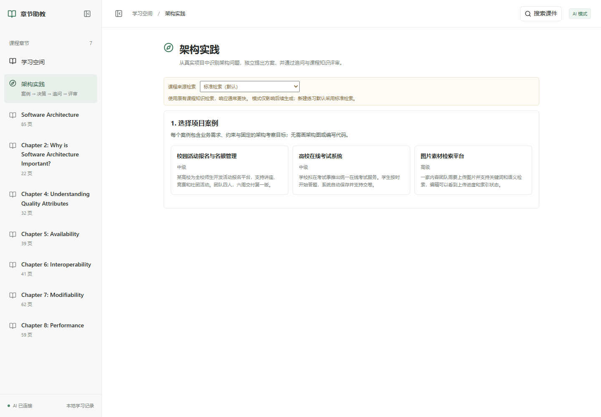 | 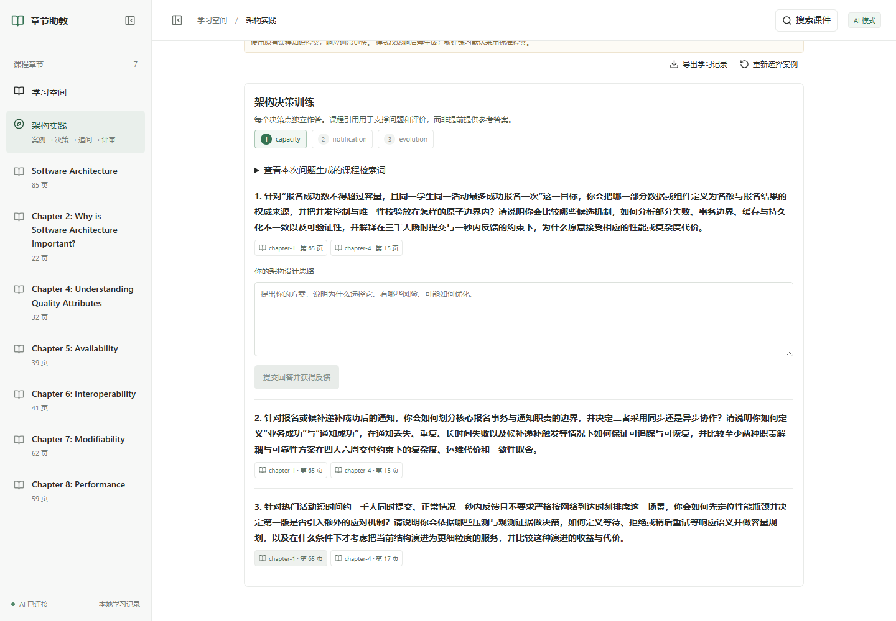 |

| 作答与追问 | 点击引用打开原始课件页 |
|---|---|
| 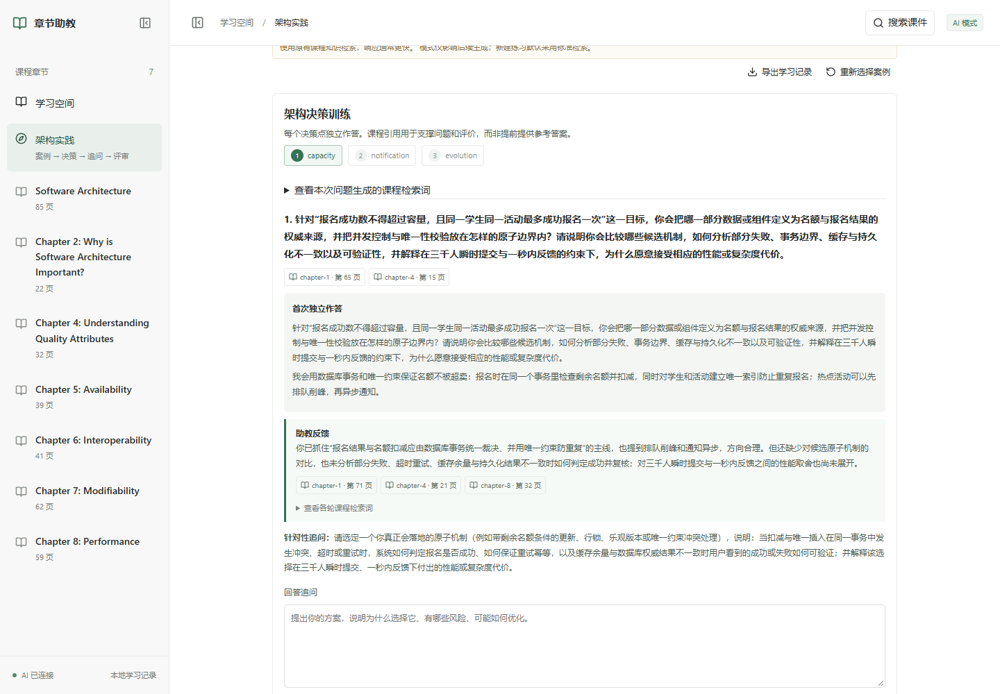 | 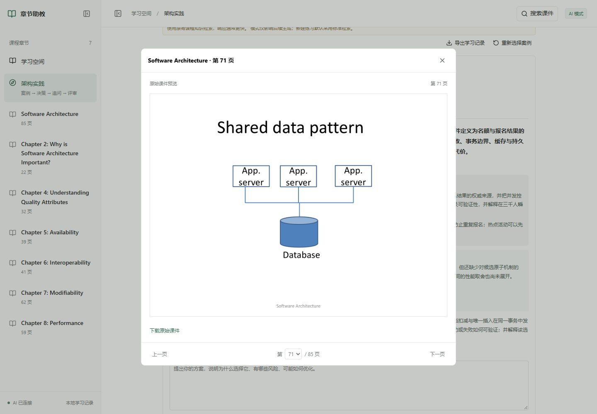 |

更多截图（hybrid 就绪、hybrid 出题、502 失败样本、首页、API 文档）见 `docs/evaluation/screenshots/`。

---

# 附录 A：技术细节与证据

> 正文的结论不变；这里放公式、完整表格、置信区间、运行环境和复现命令，供答辩/复核使用。

## A.1 数据与标签

- 文件：`docs/fixtures/retrieval-benchmark-v1.json`
- 9 概念 × 4 问法 = 36 条；同一概念四种问法共享标注页。
- 相关度：2=直接定义/解释；1=例子/场景/总结/密切相关战术；未列出按 0。
- 单一标注者，无 κ；概念级标注，不是全页穷尽池。

## A.2 L1 / L2 与指标公式

- L1：同一批人工英文 Query，比较 `baseline` 与 `hybrid`；K=10。
- L2：用户原始 Query；`baseline` 原始 Query，`llm_assisted` 先规划再词法，`hybrid` 原始 Query（CJK 先翻译）；K=8（生产来源上限）。
- `translated_lexical`：只复用 hybrid 的翻译步骤，再走 `search_all`；不是产品模式。
- nDCG@K：`gain = 2^grade − 1`，`discount = 1/log2(rank+1)`，IDCG 用标注全集。
- Recall@K：Top-K 命中的相关页 / 全部标注相关页。
- MRR：第一个相关页的倒数排名；Hit@5：Top-5 是否至少一个相关页。
- 95% CI：2000 次 percentile bootstrap，种子 `20261126`；失败零填充，错误数单列。

## A.3 完整结果表

**L1（K=10）**

| 类别 | baseline nDCG@10 | hybrid nDCG@10 | 差值 |
|---|---:|---:|---:|
| 英文术语 | 0.609 | 0.643 | +0.034 |
| 中文自然语言 | 0.268 | 0.426 | +0.158 |
| 中英混合 | 0.576 | 0.723 | +0.147 |
| 约束型 | 0.359 | 0.644 | +0.285 |
| **全部** | **0.453** | **0.609** | **+0.156** |

**L2（K=8）**

| 类别 | baseline | llm_assisted | hybrid | translated_lexical |
|---|---:|---:|---:|---:|
| 英文术语 | 0.581 | 0.558 | 0.607 | 0.581 |
| 中文自然语言 | 0.025 | 0.067 | 0.428 | 0.189 |
| 中英混合 | 0.475 | 0.426 | 0.665 | 0.592 |
| 约束型 | 0.020 | 0.032 | 0.560 | 0.107 |
| **全部** | **0.275** | **0.271** | **0.565** | **0.367** |
| p50 / p95 ms | 142 / 168 | 3018 / 4685 | 2605 / 3659 | 1520 / 2240 |
| 回退 | — | 6/36 | — | — |

## A.4 配对统计（同一 Query，2000 次 bootstrap）

| 对比 | 类别 | 平均 Δ nDCG | 95% CI | 胜/平/负 | 判读 |
|---|---|---:|---|---:|---|
| hybrid − baseline | 全部 | +0.290 | [0.195, 0.394] | 31/1/4 | 有证据更好 |
| hybrid − baseline | 中文自然语言 | +0.403 | [0.214, 0.600] | 9/0/0 | 有证据更好 |
| hybrid − baseline | 约束型 | +0.540 | [0.390, 0.693] | 9/0/0 | 有证据更好 |
| hybrid − baseline | 中英混合 | +0.190 | [0.046, 0.358] | 8/0/1 | 有证据更好 |
| hybrid − baseline | 英文术语 | +0.025 | [−0.030, 0.104] | 5/1/3 | 未证明 |
| hybrid − 翻译+词法 | 全部 | +0.198 | [0.114, 0.293] | 27/1/8 | 嵌入有增量 |
| hybrid − 翻译+词法 | 中文自然语言 | +0.239 | [0.075, 0.409] | 8/0/1 | 嵌入有增量 |
| hybrid − 翻译+词法 | 约束型 | +0.453 | [0.259, 0.646] | 8/0/1 | 嵌入有增量 |
| llm_assisted − baseline | 全部 | −0.004 | [−0.038, 0.026] | 5/27/4 | 未证明 |
| translated_lexical − baseline | 全部 | +0.092 | [0.035, 0.157] | 16/16/4 | 有证据更好 |
| L1 英文 − L2 原始 | 全部 | +0.178 | [0.111, 0.259] | 24/8/4 | 语言/查询构造是主因 |

## A.5 OCR 影响

| 策略 | 类别 | Δ nDCG | 95% CI | 胜/平/负 | 判读 |
|---|---|---:|---|---:|---|
| baseline | 全部 | −0.064 | [−0.110, −0.029] | 1/18/17 | 有证据更差 |
| hybrid | 全部 | −0.045 | [−0.107, 0.019] | 11/5/20 | 未证明 |
| hybrid | 中文自然语言 | −0.008 | [−0.232, 0.195] | 6/0/3 | 未证明 |
| hybrid | 约束型 | −0.108 | [−0.191, −0.011] | 1/0/8 | 有证据更差 |
| llm_assisted | 全部 | −0.078 | [−0.141, −0.022] | 6/13/17 | 有证据更差 |
| translated_lexical | 全部 | −0.082 | [−0.141, −0.031] | 4/12/20 | 有证据更差 |

旧 20 条固定查询旁证：当前含 OCR 环境 16/20 命中；无 OCR 历史记录 18/20，方向一致，但不是严格同一时点配对。

## A.6 环境、网络与 OCR

- 日期：2026-11-27 20:43（Asia/Shanghai）；分支 `yjp/final_develop`。
- 模型：DeepSeek `deepseek-flash`；Jina `jina-embeddings-v3`（经 `127.0.0.1:7890` 代理）。
- 索引：`data/retrieval/index.sqlite3`，340 页；OCR 后增量更新 82 页。
- 页图：340 张（1600×1200）；OCR：82 个稀疏页（项目默认只处理稀疏页）。
- 运行规模：216 行（L1 72 + L2 144）；1 个翻译 JSON 解析错误（`heartbeat-constraint`，零填充）。
- 回归：268 后端 / 162 前端 / 27 E2E；构建与 500 行检查通过。

**Jina 网络**：直连被校园 DNS 拦截（返回非 Jina 地址、TCP 超时、索引 0 页）；根因是自动化 shell 未继承 Windows 系统代理。通过代理后 `r.jina.ai` 200、`api.jina.ai` 401（可达），首次建索引 340 页，OCR 后更新 82 页。证据：`evidence/hybrid-network.txt`、`evidence/ocr-render-run.md`。

**失败样本**：hybrid 实践 `POST /api/practice/plan` 出现过 502（AI 输出无法识别），重试后 200；证据：`evidence/practice-plan-502.txt`、`screenshots/11-hybrid-error.png`。

## A.7 复现

```bash
# 0) 应用与报告依赖
.venv/Scripts/python.exe -m pip install -r requirements.txt
.venv/Scripts/python.exe -m pip install -r requirements-report.txt
npm --prefix web ci

# 1) 页图（Windows 桌面版 PowerPoint，先关闭 PowerPoint）
powershell.exe -NoProfile -STA -ExecutionPolicy Bypass -File scripts/render-slides.ps1

# 2) OCR（rapidocr 要求 Python <3.13；本机用 Python 3.12 独立 venv）
py -3.12 -m venv data/evaluation/ocr-venv
data/evaluation/ocr-venv/Scripts/python.exe -m pip install -r requirements.txt -r requirements-ocr.txt
data/evaluation/ocr-venv/Scripts/python.exe scripts/ocr-slides.py

# 3) 建索引（必须继承代理）
HTTPS_PROXY=http://127.0.0.1:7890 .venv/Scripts/python.exe -m server.retrieval_index

# 4) 四策略评测
HTTPS_PROXY=http://127.0.0.1:7890 \
NO_PROXY=api.deepseek.com,127.0.0.1,localhost \
.venv/Scripts/python.exe scripts/evaluate_strategies.py \
  --levels l1,l2 --strategies baseline,llm_assisted,hybrid,translated_lexical \
  --output data/evaluation/retrieval-run-with-ocr.json

# 5) 统计 / OCR 对比 / 图表
.venv/Scripts/python.exe scripts/eval_stats.py \
  --results data/evaluation/retrieval-run-with-ocr.json \
  --output docs/evaluation/results/stats-with-ocr.json
.venv/Scripts/python.exe scripts/compare_ocr_effect.py \
  --before docs/evaluation/results/retrieval-run-with-hybrid.json \
  --after data/evaluation/retrieval-run-with-ocr.json \
  --output docs/evaluation/results/ocr-effect.json
.venv/Scripts/python.exe scripts/render_eval_charts.py \
  --results data/evaluation/retrieval-run-with-ocr.json

# 6) 指标单测
.venv/Scripts/python.exe -m unittest scripts/test_eval_metrics.py

# 7) 截图（需先启动 8000/5173；Windows 用 Edge）
node scripts/capture-evaluation-screenshots.mjs
node scripts/capture-hybrid-screenshot.mjs

# 8) Word 报告
.venv/Scripts/python.exe scripts/build_eval_docx.py
```

## A.8 产物清单

| 文件 | 内容 |
|---|---|
| `docs/fixtures/retrieval-benchmark-v1.json` | 36 条标注 Query |
| `docs/evaluation/results/retrieval-run-with-ocr.json` | 最终运行结果（Top-8、延迟、诊断） |
| `docs/evaluation/results/retrieval-rows-with-ocr.csv` | 扁平化逐条结果 |
| `docs/evaluation/results/stats-with-ocr.json` | bootstrap 均值/差值/CI/胜负平 |
| `docs/evaluation/results/retrieval-run-with-hybrid.json` | 无 OCR 基线运行（OCR 前后对比用） |
| `docs/evaluation/results/ocr-effect.json` | OCR 前后配对差值 |
| `docs/evaluation/results/legacy-retrieval-20-with-ocr.json` | 旧 20 条固定查询旁证（16/20） |
| `docs/evaluation/generated-tables.md` | 自动生成的 Markdown 表格 |
| `docs/evaluation/charts/*.svg` / `charts/png/*.png` | 7 张图（SVG + Word 用 PNG） |
| `docs/evaluation/screenshots/*.png` | 真实界面截图（含原始页图与 502 样本） |
| `docs/evaluation/evidence/` | Jina 网络、OCR/页图、502 的原始证据 |
| `docs/evaluation/MAGA_检索评测报告_通俗版_2026-11-27.docx` | Word 版报告 |
| `scripts/evaluate_strategies.py` / `eval_metrics.py` / `eval_stats.py` / `render_eval_charts.py` | 可复现脚本 |
| `scripts/compare_ocr_effect.py` / `evaluate_local_hybrid.py` | OCR 对比 / 可选本地 ONNX 实验 |
| `scripts/build_eval_docx.py` / `render_charts_png.mjs` | Word 与图表导出 |
| `scripts/test_eval_metrics.py` | 指标单测（6 项） |

## A.9 与第 5 人交接的对应关系

| 第 5 人 P1 要求 | 本轮状态 |
|---|---|
| 构造中英/术语改写/约束型 Query 集 | 已完成 36 条（9 概念 × 4 问法），单一标注 |
| 比较三策略 Recall@K / MRR / nDCG / 延迟 | 完成 baseline / llm_assisted / hybrid；另加翻译消融 |
| 教师审核的评价要点、独立答 vs 追问修正 | 未完成完整 27 份；仅 1 案例冒烟截图 |
| 引用是否语义支撑论断 | 仅抽样 1 条人工观察；未做统计 |
| 结果可复现、保留负面样本 | 完成：JSON/CSV/夹具/脚本/CI 单测；负面样本见 A.5 |
| 不把 Mock 当真实 | 完成：真实 DeepSeek + 真实 Jina（经代理）；失败样本保留 |
| 页图/OCR 与引用预览 | 完成：340 张页图 + 82 个 OCR 文本；引用弹窗显示原始页 |

## A.10 图表可访问性

- 多系列颜色经 CVD 校验（蓝/橙/青/紫）；青色在浅色底对比度低于 3:1，已用直接数值标签 + 完整表格作为 relief。
- 每张图都有对应 Markdown 表格；色觉/打印用户可只读表。
- SVG 内置 `prefers-color-scheme` 深色模式。
