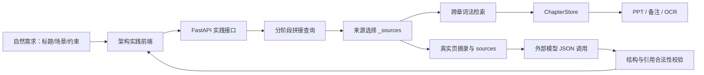

# 第三轮 Phase 1：工程与问题基线

归档日期：2026-11-15。本文保存开发前事实；任务范围与验收见 [任务定义](phase1-task-definition.md)。本次归档仅静态核对与读取已有产物，未重跑测试、调用模型或修改业务代码。

## 1. 背景与证据口径

MAGA 是面向软件体系结构课程本科生的 AI 教学助手，已有课件浏览、检索、问答、自测和架构实践。本轮目标为“一个产品主任务 + 一个架构实践闭环 + 一套可复用报告与交接材料”。Phase 1 已完成架构与测试基线核对、用户任务诊断；人工最终选择改善自然设计需求到课程知识来源的匹配，不在此确定实现路线。

证据标签：**已验证事实**为此前实际执行结果；**静态确认**为当前代码核对；**合理推断**不是已复现的产品后果；**人工决策**见任务定义；**待验证**留给后续阶段。Task 1/2 的原始过程在本次 Codex 对话中，部分终端输出没有独立日志，本文将必要输入与结果摘要归档，不能称为完整原始验收记录。

本轮 Phase 1–4 新增 Markdown 文档统一放在 `docs/iteration3_jack/`，不移动历史材料；后续沿用此根目录，保持证据连续性。

## 2. 与主任务有关的架构

**静态确认：** React/TypeScript/Vite 前端 + FastAPI 模块化单体。浏览器 localStorage 保存学习和实践状态，没有数据库、账号或云同步。知识源是本地 PPT 正文、表格、备注及可选 OCR；页图供阅读，PDF 未建立全书索引。检索采用词法匹配，没有向量数据库。

| 组件/函数 | 当前责任 |
| --- | --- |
| [DesignStudio.tsx](../../web/src/DesignStudio.tsx)：生成相关函数 | 收集标题、场景、需求；保存草稿并组织分阶段请求 |
| [api.ts](../../web/src/api.ts)：designScenarios/designTactics/designReview | 请求与前端运行时结构检查 |
| [main.py](../../server/main.py)：create_app | 装配 `/api/design/scenarios`、`tactics`、`review` 路由 |
| [models.py](../../server/models.py)：Design*Request/Response | 输入与输出契约 |
| [design.py](../../server/design.py)：design_scenarios/design_tactics/design_review | 分阶段查询组织、上下文、模型结果校验 |
| 同文件：_sources | 调用跨章检索，去重，读取原页并构建摘录 |
| [search.py](../../server/search.py)：search_all | 标题、正文、备注、OCR 词法计分与排序 |
| [retrieval_terms.py](../../server/retrieval_terms.py) | 中英术语扩展、查询词处理与匹配边界 |
| [chapters.py](../../server/chapters.py)：ChapterStore | PPT 解析缓存、真实页码、页图和 OCR |
| [tutor.py](../../server/tutor.py)：excerpt | 有限摘录及 OCR/未解析图形提示 |
| design.py：_complete_json/_canonical_citations | 外部调用、错误映射、引用范围检查与真实标题重建 |



当前数据流细节：

- 初始场景分析直接拼接 `title + scenario + requirements`；战术阶段另加入质量属性名、刺激和响应；评审阶段加入属性名、战术名。各阶段重新选择来源。
- `_sources` 规范空白、截取查询前 2000 字符，调用 `search_all(..., MAX_SOURCES=8)`；按 `(chapterId, slide)` 去重，再用 `excerpt` 生成来源内容。
- `search_all` 遍历章节；标题命中权重为 3，正文、备注、OCR 为 1；排序后截断。分数不是语义相关概率。
- 来源通过 JSON 的 `sources` 字段进入各阶段模型请求。无来源返回 422；有非空结果不等于知识充分。
- 模型调用仅在服务端，实践配置 httpx 60 秒超时；结构化输出经 Pydantic 检查，引用必须属于本次来源，标题从真实材料重建。页码合法不能证明结论被引用内容支持。

基础意图见 [历史 ADR-001–004](../archive/spec/architecture.md)：模块化单体、轻量检索、结构化教学动作、真实课件优先与明确降级。ADR-002 原为章节内检索意图，当前已有跨章搜索和实践，不能将历史描述误作全部现状。

既有约束：不伪造离线教学；无配置返回 503；资料视为不可信输入；保持前后端校验、真实引用和本地状态恢复；手写源码与测试单文件不超过 500 行；新增依赖须有必要性与权衡依据。参考 [贡献指南](../../CONTRIBUTING.md)、[当前接口](../FEATURES_AND_INTERFACES.md)。贡献指南中“没有检索评测脚本”等描述已滞后，以实际代码为准。

## 3. 系统与测试基线

### 3.1 工程和环境

- 分支：`iteration/jack`；HEAD：`b000353fbafb8fc2a545ac30808ae4ab739cf2b3`，`docs: add hgj project handoff and work log`。
- 归档前工作区：`.gitignore` 已修改，`docs/architecture-evidence-audit.md` 未跟踪；本次保留。根 `AGENTS.md` 被本地忽略，是协作提示而非唯一可交付证据。
- Task 1 环境：Windows PowerShell；conda `maga`，Python 3.11.18；Node 22.17.1、npm 10.9.2。默认 Python 缺依赖不代表 `maga` 缺依赖。
- 已记录后端版本：FastAPI 0.162.7、httpx 0.28.1、Pydantic 2.14.3、pytest 9.2.0、python-pptx 1.0.2、python-dotenv 1.2.4、uvicorn 0.54.0。
- 本地资源计数为 340 个 PNG、82 个 OCR TXT；未逐页核验。`data/` 被忽略，其他机器不保证具备相同内容。

### 3.2 已执行结果（归档时未重跑）

以下命令在根目录执行；`python` 应指向 `maga`。无模型测试子进程设置 `PYTHON_DOTENV_DISABLED=1` 并清除 `LLM_API_KEY/LLM_MODEL/LLM_BASE_URL`，不改 `.env`。

| 命令/记录 | 已有结果 | 证据边界 |
| --- | --- | --- |
| `python -m pytest server/tests -q --tb=short --basetemp <全新目录>` | Task 1：178 项通过，1 条 Starlette/httpx 弃用警告 | 对话终端结果；默认临时目录曾失败，换到仓库内后通过 |
| `npm.cmd --prefix web test` | Task 1/2：149 项通过，20 个文件 | 测试替身不代表真实教学效果 |
| `npm.cmd --prefix web run build` | Task 1：通过 | 本地构建，不代表远端 CI |
| `node --test scripts/check-file-lengths.test.mjs` | 2 项通过 | 检查器自身测试 |
| `node scripts/check-file-lengths.mjs` | 93 个手写文件，0 超限 | Task 1 快照 |
| `git diff --check` | Task 1：通过 | 工作区空白检查 |
| `npm.cmd --prefix web run test:e2e`，默认 Edge | 25 项启动失败 | 未进入业务断言，不能当作功能回归 |
| Chrome 通道 E2E，见下文 | 后续记录为25项通过 | 使用 API 测试数据，不是完整真实后端/模型联调 |
| `python -m pytest server/tests/test_quiz.py server/tests/test_design.py server/tests/test_search.py -q --tb=short --basetemp <全新目录>` | Task 2：56 项通过，1 条警告 | 相关回归，不是新问题学习价值评估 |

**较新证据修正：** 根协作记录记载同日 Chrome 157.0.8103.51 启动成功、25 项 E2E 通过、耗时24.8秒；归档时读取的 [独立 .last-run.json](../../data/verification/chrome-e2e-7c031e3b8b2c40acb7fe45a6934a6684/.last-run.json) 为 `status: passed`、`failedTests: []`。该文件不含数量、版本和耗时，后者来自协作记录，未在本次独立复测。Edge 根因仍未查明。后续本机按用户已有偏好显式设置 `$env:PLAYWRIGHT_CHANNEL='chrome'`；配置见 [playwright.config.ts](../../web/playwright.config.ts)。

完整启动方式见 [README](../../README.md)：后端 `python -m uvicorn server.main:app --host 127.0.0.1 --port 8000`；前端 `npm.cmd --prefix web run dev -- --port 5173`，`/api` 代理到8000。真实模型的当前可用性、实际生成质量、取消后的上游生命周期、完整真实联调仍未充分验证。

### 3.3 固定检索评测

入口：[脚本](../../scripts/evaluate-retrieval.py)、[原期望集](../fixtures/retrieval-terms.json)。原命令：

```powershell
python scripts/evaluate-retrieval.py --repo . --cases docs/fixtures/retrieval-terms.json --output data/verification/phase1-task1-retrieval.json
```

已读取 [本地结果](../../data/verification/phase1-task1-retrieval.json)：历史代码基线 `44a1e3f` 为 **8/20**，当前为 **16/20**；未命中 `performance`、`性能`、`security`、`安全性` 的固定期望页。含义仅是20条查询 Top-5 包含至少一个指定核心页，不是“无结果”，也不是回答准确率。

[历史交接](../hgj交接文档/HANDOFF.md) 记录10/20 → 18/20，与本次不同。差异原因尚未确认，需检查课件/OCR等输入条件，不能直接认定代码退化。原评测集以术语为主，不能充当本轮自然需求匹配的充分验收集。已有结果不得覆盖；复跑应使用新输出路径并记录环境。

## 4. 主任务问题证据

### 4.1 Task 2 实际输入与结果

**已验证事实：** 使用本地真实课件和现有 `_sources`，未调用模型。实际输入保留如下，不能把简写当作已单独运行的同一案例：

```text
在线考试系统 如何提高在线考试系统的可用性 峰值1万人，考试期间不能中断
```

按顺序返回：`chapter-1:9`、`chapter-1:14`、`chapter-1:27`、`chapter-1:12`、`chapter-1:28`、`chapter-1:51`、`chapter-8:38`、`chapter-1:32`。包括电商、12306、北斗、UNIX、地下迷宫等案例，没有第5章来源。

术语对照 `可用性 故障恢复` 返回：`chapter-5:26`、`:9`、`:13`、`:6`、`:11`、`:12`、`:24`、`:25`，含可用性定义、场景和恢复战术。

用户概括“在线考试系统，峰值1万人，考试期间不能中断”与实际输入表达同类需求，但实际复现文本还显式包含“可用性”。将标题、场景、约束分别填入 UI 的真实完整链路尚未作为独立案例验收。

### 4.2 最小复现入口

从根目录，在现有 `maga` 环境运行以下 Python；不需要 Key、不访问模型、不写评测结果：

```python
from pathlib import Path
from server.chapters import ChapterStore
from server.design import _sources

store = ChapterStore(Path('book'), Path('data/slides'))
queries = [
    '在线考试系统 如何提高在线考试系统的可用性 峰值1万人，考试期间不能中断',
    '可用性 故障恢复',
]
for query in queries:
    print(query, [(s['chapterId'], s['slide'], s['title'])
                  for s in _sources(store, query)])
```

Task 2 原始列表来自对话终端输出，未另存独立日志；上面是可重现摘要，不是本次归档新执行结果。结果可能受本地OCR与课件影响，后续应保存输入清单或签名。

### 4.3 结论边界

- **已验证：** 此例自然需求与术语查询的来源明显不同，自然需求没有返回可用性专章。
- **静态确认：** 查询直接拼接并按词法排序，非空检查和引用合法性检查不检验语义充分性。
- **合理推断：** 该需求与可用性/恢复有关；遗漏相应材料可能削弱分析的课程依据，迫使初学者先知道术语。
- **待验证：** 各候选来源逐页相关性、问题的普遍性、真实模型是否产生不充分结论，以及各阶段重检索能否弥补初始缺失。不得宣称所有需求失败或模型必然答错。

## 5. 架构问题与质量属性

| 关注点 | 初步判断与后续证据需求 |
| --- | --- |
| 职责/交互 | 需求组织、排序、来源摘录和生成有现成边界；需分析需求到课程概念的转换应由谁负责，尚未选定方案 |
| 适用性/正确性 | 页存在、分数高、引用合法与“对用户需求有用”不同；需人工评定相关知识及来源覆盖 |
| 可追溯性 | 保留需求、查询、来源、模型上下文与最终引用的对应；当前不能仅凭引用证明结论可靠 |
| 性能/可靠性 | 新处理可能增加调用、延迟或故障点；尚无本轮耗时/成本指标基线 |
| 可修改性/复杂度 | 共享检索词表可能影响搜索、问答和自测；局部修改需有回归证据，不能为此默认全面替换检索 |

Phase 2 应补自然需求评估基线、根因与质量属性场景、方案比较和人工决策。本文不新增 ADR，不事后虚构历史取舍。
