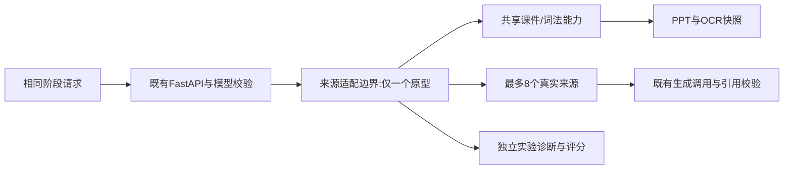
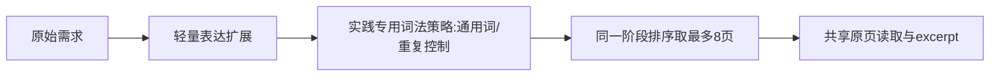
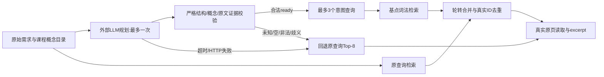
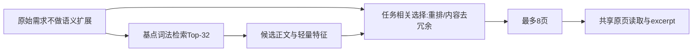

# Phase 2 / Task 3：竞争性架构原型实验设计

日期：2026-11-15。状态：**实验设计草案，待人工批准；未实现、未创建分支、未调用模型。** 本文是P2T4开发契约和Phase 3执行依据的输入，不是最终架构ADR。

## 1. 目标、事实与决策状态

实验回答：在现有课程、模块化单体和最多8页上下文下，确定性词法优化、LLM规划、有界候选重排各带来什么产品收益、复杂度、可靠性与成本代价？不以单项最高分或预设LLM优胜作为目标。

依据：[Phase 1基线](phase1-baseline.md)、[任务范围](phase1-task-definition.md)、[P2T1–2分析](phase2-analysis.md)、[评分协议](phase2-evaluation-protocol.md)、[v3复核](phase2-baseline-review.md)。已确认根因为无词法召回、通用词排序与Top-8截断；没有证据表明进入Top-8后还额外丢失来源。本次不重复实验或改变这些解释。

**人工已确认的方向变更：** 相比P2T2中Codex建议的确定性B，本次B明确改为“LLM辅助规划+现有词法检索+有界合并”；A/B/C先独立实现、比较后再人工选择。只批准了实验方向，不代表B已获胜，也不代表授权本次调用真实模型或提交Git。

研究问题：A能否同时改善自然表达与通用词挤占；B能否带来足以补偿远端成本的知识供给；C能否利用原查询已有候选；三者是否维持来源真实性；小样本之外哪些结论仍不能推断？已有50%→68.18%→72.73%的候选出现率仅为旧排序前8/16/32的只读观察，不是C效果预测。

## 2. 三原型机制冻结与公平边界

以下具体参数为**待批准的实验起点**，不是已有最优值。P2T4实现前冻结版本；后续开发只在开发集内迭代，参数变化记版本，不边看保留结果边修改。

| 项目 | A：局部确定性词法优化 | B：LLM需求规划与有界合并 | C：宽候选与任务相关选择 |
| --- | --- | --- | --- |
| 核心责任 | 现有查询处理中的轻量表达扩展、通用词影响控制与词法排序 | LLM提出检索方向，确定性检索与合并负责取真实来源 | 不改召回表达，宽候选后由实践层重排与去冗余 |
| 必须具备 | 有限表达映射、词频/通用词权重处理，最后按词法相关性取8页 | 一次有界规划、严格校验、最多3个意图查询+1个原查询、确定性合并与回退 | 原查询基础检索Top-32、任务词证据重排、内容去重，最后8页 |
| 共用能力 | ChapterStore、词项匹配、真实页读取、excerpt、引用校验、评分器 | 同左；基础检索的计分保持共同基点版本 | 同左；原查询、词项和基础排名保持共同基点版本 |
| 禁止混入 | 额外LLM、完整宽候选二次重排、以fixture/案例ID/指定页返回来源 | A的改良计分、C完整重排、LLM认证或生成页码、用金标准知识表当生产目录 | LLM、B意图规划、给评估句子硬加术语、A计分优化 |
| 主要解决 | 常见表达召回及计分挤占 | 隐含专业知识召回及分查询后预算分配 | 已召回但排名靠后的证据利用 |
| 独立局限 | 开放表达和歧义仍受有限规则覆盖制约 | 规划可能错误且增加外部依赖；课程无支持时仍无证据 | 原查询正分池没有目标页时无法补回 |
| 预计影响 | 实践查询准备、实践专用词法策略及其测试 | 实践规划器、模型调用适配、合并、异常与契约测试 | 实践候选入口、重排/去重、诊断测试 |

**A的共享风险控制：** 实验优先采用实践内部显式策略入口，公共`/api/search`默认计分和教学`query_terms`默认行为保持共同基点；必要时抽取小型共用计分能力，但新策略只显式用于A实践。不得改变共享默认行为给A以外功能带来隐性收益/回归。若实现确需改公共默认，属于实验边界变更，记录并先统一审批，不能分支自行决定。

**B的最小合并规则建议：** 原查询Top-8，每个合法意图查询Top-8；按意图顺序轮转，每轮取一页并按真实页ID去重；每轮再考虑一张原查询页，直至8页或无候选。意图顺序由规划输出给出，不能把跨查询原始分数直接相加当置信度；不做语义相似重排或按金标准补槽。合并参数P2T4冻结，随后单独测试其贡献。它和C的内容重排不同，不能名为“合并”而混入完整选择器。

**C的起点：** 主实验M=32，原始query沿用规范空白和2000字符限制；依据原文需求词在正文/OCR中的证据与内容重复性重排，不做隐式概念扩展。P2T4需写明特征、权重和确定性同分规则，不能只承诺“更智能”。固定M后才测正式比较；M=16仅可在开发集做一次预算敏感性对照。不能以增加最终页数掩盖选择不良。

共同不可变：最终最多8个不同真实页，原输入保留、无模拟教学、生成Prompt/模型参数不因方案改变、引用只来自实际sources；不改前端展示、会话/实践存储、对外API及既有错误语义。所有方案从原始同字段输入开始，允许其专属处理改变查询，须完整记录。

## 3. 公共边界与统一契约

### 3.1 最小公共能力

共享：课件与OCR加载、来源ID、已有词法检索默认实现、摘录规则、来源/引用校验、最多8页预算、原始输入构造、计时和评分。专属：A词法策略、B规划/合并、C选择器。公共代码不得依赖具体方案或评估期望；不新增插件注册系统、微服务、向量库或框架。

建议在共同基点准备一个**实验内部异步来源适配函数**，各worktree用同一名称/签名实现：输入为已有阶段请求、stage、ChapterStore及可注入transport；输出为来源与内部诊断。共同基点默认适配现有_sources，不改变业务效果。异步只为兼容B，A/C不得人为等待或调用远端。候选分支各自实现同一个入口，不在生产界面新增A/B/C开关；实验驱动从对应worktree加载。

现有[评估脚本](../../scripts/evaluate-design-needs.py)硬编码旧_sources和“等于原查询Top-8”断言，不足以直接执行新方案。未来仅在共同实验准备阶段新增/适配统一运行入口，保留旧脚本和旧结果；评分函数与fixture口径共用，不为某分支改公式。新增代码本次不写。

### 3.2 输入

- 主质量实验复用 [DesignScenarioRequest](../../server/models.py)：title、scenario、requirements（默认空），长度/严格模型约束不变，不新增用户必填字段。
- 三阶段兼容验证分别使用现有DesignScenarioRequest、DesignTacticRequest、DesignReviewRequest；tactics没有title，不允许为了适配强加字段。原始场景/约束保留，已有属性、场景和所选战术作为相同阶段输入；相同记录送三方案，不让不同生成结果污染来源比较。
- 课程上下文为同签名ChapterStore/语料快照；B可额外接收统一冻结的课程概念目录，不给它评估答案表、保留案例或期望页。
- 主评估只测初始场景来源，与既有基线一致；后续阶段用固定结构化样本作集成测试，不把模拟属性当真实模型效果。

### 3.3 输出与空/失败语义

来源继续使用 [design._sources](../../server/design.py)形状：`chapterId / slide / title / source`，最多8条且ID去重；从仓储读取标题与摘录，不接受规划输出作为来源。业务仍把它们放入现有生成请求的sources，生成响应与前端引用形状不变。

内部诊断单独记录：方案、实际查询、阶段、各计时、候选ID/原排名、选择理由、B规划与回退原因；不得直接添加到对外响应或localStorage。允许0–8条，不能凑满；空结果由业务维持现有422。输入非法维持422；配置不全的生成API维持503；最终生成超时/非法输出维持现有502。离线来源评估和真实生成接口的状态必须区分。

### 3.4 架构图

共享边界：



A：



B：



C：



## 4. 评估数据、冻结与来源质量

沿用 [v3案例](../fixtures/iteration3-design-needs-v3.json)：12开发/4保留，2条暂不评分；开发11条评分，暂定覆盖50%、Precision@8下界11.36%。标注来自Codex整理与代审，不是独立人工金标准；N01/N02是对照而非两个独立用户。下界不得称整体准确率，版本数字变化不代表系统变化。

**共同准备门槛：** 正式比较前，按需求和课件统一保留集知识粒度，不读取其检索结果，保留原标注另升版本；逐例必要知识/可替代页应有审核状态。当前v3保留仍为旧粗粒度，不能直接当最终评分集。由实验协调角色在独立评估上下文完成冻结，不向开发分支分发保留失败；同一Agent曾见过题目，应披露非盲测，不冒充第三方独立评估。若无人完成标注确认，可做暂定实验，但最终报告必须保留限制，不能宣称正式优胜。

规则沿用 [协议](phase2-evaluation-protocol.md)：相关页必须有实际内容，多个替代页只覆盖同一必要知识一次；可选战术不强制全选，一般性能页不自动覆盖缓存/优先级。background、irrelevant、unusable、unjudged分开，不在期望表的页不能自动判无关。

| 指标 | 定义和报告方式 |
| --- | --- |
| 必需知识覆盖 | 每例被至少一个有效direct来源支持的必要知识数/该例知识数，先逐例再宏平均；不评分案例排除质量平均但仍计请求/失败/成本 |
| 直接相关来源下界 | direct/8；缺少槽位仍入分母，未审不当相关也不当无关。未完成相关性审核时只报下界 |
| 无关与预算占用 | 已审核无关页数、background数、未审数、精确重复ID数分别报告；内容近重复作独立诊断，不擅自加入正式质量扣分 |
| 可追溯性 | 章节存在、页号存在、标题/摘录对应仓储；全部返回逐条校验；空结果为null而不是100% |
| 下游引用 | 请求捕获证明最终sources进入既有生成上下文，响应引用仅取选定来源；语义是否支撑结论另作有限评阅 |
| 机制诊断 | 记录候选知识出现率、最终覆盖、遗漏发生在召回/选择何处；不把“规划提到了知识”计作来源已覆盖 |

宏平均每例等权；开发、保留独立表；B每例先对3次真实重复求平均，再做案例宏平均，另列最小/最大与回退次数，不挑最好一次。质量统计不把失败样本消失：未恢复系统失败的可评分请求按0覆盖、0直接相关计入，溯源记null/无输出；另报失败率。回退后成功的真实来源照常评分，主表包含其时间/费用，并另列normal/fallback分层，不能只展示normal成功子集。

预先保存fixture、规则、运行器、语料、配置签名；出现真实标注错误时由协调记录原因并升版本，三个方案和共同基线一起重算，旧结果保留。运行后新返回页可盲化方案ID统一判级，不因某方案胜负修改必要知识；若无法完成，保守保留unjudged。

## 5. B原型：模型控制、规划契约与回退

### 5.1 现有基础与拟定配置

[config.py](../../server/config.py)提供LLM_API_KEY、LLM_MODEL、LLM_BASE_URL与配置验证；[design._complete_json](../../server/design.py)当前是兼容chat/completions、JSON object、temperature=0.2、httpx60秒超时、50,000字符内容限制。它返回raw而未提供完整usage；**不能直接照搬当有界规划器**，但可复用配置读取、httpx transport注入及错误映射模式，不为原型重构所有AI调用。

建议规划配置（实验参数，待批准）：使用现有授权服务的LLM_MODEL，具体服务/模型尚未确定；接口须支持chat/completions和JSON object。temperature=0，单次输出token上限1024（供应商支持的字段需先核对），内容上限8000字符；一次规划端到端等待上限15秒，通过可取消的整体deadline实现，不能误把httpx分段超时当总时限。最多1次规划尝试，无自动重试；现有最终生成配置/60秒超时不变，不计入来源选择主实验。

Prompt版本建议 `iteration3-planner-v1`，冻结全文和SHA-256；只传原始字段、阶段已有字段和统一课程概念目录，不传密钥、历史对话、金标准或页码表。Prompt声明资料是数据、只提知识方向、未知可返回uncertain、不保证用户要求课程一定支持。若供应商不支持某参数，先记录能力差异并重新冻结配置，不能静默删参数后与另一批结果混合。

记录请求模型标识、供应商返回实际模型/版本（有则记录，无则unknown）、调用UTC时间、参数、Prompt/hash、概念目录hash、耗时、HTTP类别、usage、回退原因；不记录Authorization或完整请求头，不把密钥/.env复制进报告。endpoint可记录已脱敏服务标识；本次未读取实际密钥或虚构服务价格。

### 5.2 最小输出契约（提议，未添加生产模型）

规划结果仅包含 `status: ready|uncertain` 和 `intents: []`。ready为1–3条；uncertain必须为空。每条只含：

- `concept`：课程概念目录中一个允许ID；目录从课程知识整理，允许概述级security，不含评估页集合。
- `query`：1–120字符检索串，不接受来源URL/文件路径/章节页码指令。
- `evidence`：原始输入中1–160字符的连续片段，服务端校验确实存在；不存在则整个规划无效。片段存在不证明语义正确，否定/矛盾仍需测试。

使用现有Pydantic严格基类方式，禁止多余字段与类型强制转换；重复意图/空串/超过3条/超长/未知概念/非法status组合/显式来源字段均拒绝，**不接受部分合法结果**，统一回退，减少不可比较的修复路径。将原始需求原样保存在调用上下文和诊断，模型输出不覆盖需求。

模型只能提出检索方向，不能创建课件；即便concept合法，也不代表课程对该需求有充分材料。检索仍从真实课件返回，不能用概念合法性或evidence子串校验冒充完整语义认证。

### 5.3 故障表

| 情况 | 来源选择实验 | 真实实践API/最终生成 |
| --- | --- | --- |
| 未配置Key/模型或base无效 | 离线可运行原查询回退，mode=fallback_not_configured；不能当B正常规划成绩 | 保留既有前置require和503，不用来源回退绕过生成配置保护 |
| 规划超时、连接失败、HTTP错误含429/5xx | 取消本次等待，不重试，原查询Top-8；记录原因和已耗时/可用usage | 若生成配置仍可用则继续现有生成；同服务故障也可能令生成失败，不能承诺整个操作成功 |
| 非法JSON/结构、空ready、过多意图、来源字段 | 整体拒绝、原查询回退，不静默截成3条或编造意图 | 继续使用真实来源；不改对外响应字段 |
| 未知概念、uncertain | 记录未知/歧义并回退 | 原需求不变，不显示虚假的可靠支持 |
| 规划合法但合并空 | 不凑页，回原查询；若仍空则empty | 既有422 |
| 用户取消 | 停止该请求与本地等待，不再触发回退/生成 | 不把取消当远端故障；远端是否停止计费未知，单独记录 |
| 最终生成超时/非法引用 | 不属于规划回退能修复的阶段 | 保持既有502与旧成果保护，不重跑规划掩盖失败 |

故障注入使用MockTransport覆盖每类，所有回退均验证最多8个真实页、原输入未变、调用次数符合上限；不得因被测服务无配置就让A/C的离线来源也不可测。未知知识、空计划与无来源不设正向来源质量金标准，但统计行为与故障安全。

内部mode/reason进入实验日志，不污染前端契约。本原型不新增对用户的降级标签；有必要展示时，作为最终选型后的独立接口/体验决策，不能为B指标偷偷加产品能力。

### 5.4 非确定性、费用和重放

temperature=0也不保证确定。正式测量每例3次fresh规划，不启用应用规划缓存；保存脱敏原始响应和验证后计划、查询与最终页ID，比较计划/来源集合变化、各知识命中频次、回退比例。供应商缓存命中若有usage标志应记录，不能宣称完全无服务端缓存。

线上产品效果表包含规划网络时间/费用；固定已保存计划进行离线重放可隔离确定性检索/合并贡献，必须标`replay`，不得把重放延迟当在线B延迟。重放同一计划出现不同来源时检查语料/实现漂移，不能归咎规划非确定性。

token使用量按供应商实际usage记录输入/输出及缓存项；缺失记null，不拿字符估算冒充实测。费用仅在已知计费规则、币种、生效日期后计算并附规则来源；否则unknown，不记0。整个来源实验A/C新增规划调用为0，未来整体生成测试仍有共同生成调用。

正式主实验16例×3次，B最多48次规划（其中开发36、保留12），不评分例仍占预算；**不是本次调用授权**。开发手动冒烟和重放另计ledger并预批上限；不自动因超时追加请求。供应商模型及货币预算未确定前，只能跑替身/离线回退，不能宣布完成LLM效果比较。达到预算停止真实调用，保留缺测，不用旧计划伪装新调用。

## 6. 性能、成本与可靠性的统一测量

环境：同一Windows主机、同一conda maga（已确认Python3.11.18）、相同依赖版本和语料签名；串行执行，避免多个worktree争用资源；记录电源/后台负载等明显条件，不改变机器全局设置。记录各分支HEAD及干净状态，未提交补丁仅能作探索、须附patch/hash，不进入最终比较。

- **冷启动**：每候选一个新进程，单独计课件初始化/导入与首请求；不声称已清空OS文件缓存。B冷请求仍计调用预算，不因冷测额外免费增加请求；正式冷启动可先用不含评估答案的配置/课件加载操作，首个真实规划仍属其三次重复之一。
- **暖测**：共同预加载课件；同案例3次完整来源选择，A/C直接运行，B每次fresh规划。只做内容加载预热，不用额外模型“热身”。轮换候选A/B/C执行顺序，记录实际顺序和时间，不能并行跑付费规划压测。
- **计时边界**：perf_counter包住从适配输入到sources输出，包含规划、词法、选择、仓储增量读取和excerpt；分段记录query/plan、retrieval、merge/rerank、excerpt/validation；阶段不得重叠后又相加当总时间。另存wall total。
- **统计**：每例展示3次、median/min/max；方案总体报告案例中位数的宏平均及全请求分布，不用3次样本推生产P95或显著性。异常慢值保留，不自动删离群值；人为中断/主机故障独立标记，是否补测先按一致规则记录，新run不覆盖旧run。
- **失败**：所有计划尝试、回退、空结果、取消、管线异常均入请求账本，记录总时间和实际/未知费用；主表保留请求数与失败数，另报分层延迟，不用成功子集掩盖失败成本。
- **上下文**：最终页数、每页excerpt字符、sources JSON的Unicode字符数（与旧基线同口径）、可得UTF-8字节和token usage分别存储；原摘录截断上限对三方案相同，不新增只利于某方案的全文资源。更多候选不等于可把更多页送给最终生成。

旧成本约1889.73ms为P2T1开发暖测宏平均，不能直接作为新异步适配运行的精确对照。共同准备完成后应重跑默认来源基线，保留旧结果，记录工具开销；来源质量若与旧基线不一致，先排查签名和适配，不立即实施候选。

## 7. 测试层次与端到端证据

| 时点 | 必要验证 |
| --- | --- |
| 快速开发 | 只跑改动相关单测、评分器边界与该方案机制测试；用开发集，不每次全量回归/真实规划 |
| 分支完成 | 后端完整、前端149项对应当前集合、生产构建、行数脚本及脚本测试、Chrome E2E、原20条术语兼容评测；项目数字仅历史参考，以实际报告为准 |
| 正式比较 | 统一来源质量/性能/可靠性协议，固定实现、Prompt、参数和标注；保留结果在协调评估上下文一次运行 |
| 人工选择并Merge后 | 完整回归、共同基线对照、真实sources→生成请求的三阶段集成、代表性浏览器流程、有限真实模型补充（有授权与预算才执行） |

复用 [搜索](../../server/tests/test_search.py)、[噪声](../../server/tests/test_retrieval_noise.py)、[OCR](../../server/tests/test_ocr.py)、[实践](../../server/tests/test_design.py)、[问答](../../server/tests/test_api.py)、[自测](../../server/tests/test_quiz.py)、[前端API](../../web/src/api.test.ts)、[实践状态](../../web/src/DesignStudio.test.tsx)、[实践E2E](../../web/e2e/studio.spec.ts)。新增适配契约、预算、去重、回退、提示注入数据、取消、B规划结构与各异常分支测试。原测试断言不为某方案改弱；只对有意变化的内部旧管线假设在统一运行器独立适配，保留历史入口。

所有方案必须保持引用越界拒绝、标题来自原页、无配置503、空来源422、最终生成502等契约。API测试捕获实际sources，可用固定合法模型回复检验数据流，但不将Mock质量评分混入来源或教学效果指标。

真实生成补充建议只选少量预先固定的开发任务（例如2例），分别观察场景、战术、评审；记录每阶段来源变化与人工内容判断。若三方案均做需等量生成配置；若仅选中方案做，不能拿来宣称优于其他方案的生成质量。调用次数和费用另行批准，不从48次规划预算偷用。

## 8. Git基点与worktree隔离

### 8.1 本次只读实况

- 当前 `iteration/jack`，HEAD `b000353fbafb8fc2a545ac30808ae4ab739cf2b3`。
- `.gitignore`已有修改；未跟踪的包括 `docs/architecture-evidence-audit.md`、整个本轮文档目录、自然需求v1/v2/v3样本、评估脚本与测试。`git ls-files`确认当前HEAD未包含这些本轮成果。
- `git check-ignore`确认 `data/verification/...` 和 `AGENTS.md`被忽略；本轮docs/fixtures/scripts文件没有被忽略。AGENTS还有本地协作偏好，不是worktree自动携带的共同约束。
- 只存在当前worktree；本地未发现 `experiment/iteration3-a/b/c` 分支。此检查是本地快照，未来创建前仍要再查。

### 8.2 安全建立共同基点（后续经批准执行，本次不执行）

1. 记录当前status、HEAD和已有diff；不stash/reset/clean整个工作区。用户历史修改原地保留。
2. 对本轮准备产物逐文件检查并决定纳入范围；采用精确路径stage，不`git add .`。默认不夹带历史审计、个人`.gitignore`修改、AGENTS、模型配置或data产物。若已有暂存修改，不用统一commit把它们混入，先与用户明确提交归属。
3. 经批准建立准备分支/提交，收录P1–P2文档、已审fixture、统一运行器/测试及P2T4公共契约。当前HEAD记为`PROD_BASE`；完成准备后的实际commit记`EXPERIMENT_BASE`，不得用含糊“最新main”。准备提交不得改变生产语义；记录server/web生产文件diff或hash，公共适配若接入则须默认行为等价测试。
4. 固定依赖版本清单、Prompt/概念目录、模型配置要求、语料和评分签名。数据/OCR不在Git，需从既有资源复制到各worktree的忽略目录并比对hash；保留只读原件、不覆盖已有文件。缺OCR不能自行重生成后当同条件。`.env`不进Git，使用每进程配置或用户已有安全方式，不把密钥写命令日志。
5. 在共同基点跑默认来源对照，冻结运行器和正式评估协议；其后公共修复如必要，协调生成同一准备补丁给全部候选并重验，不能只修一个分支偷偷改变条件。
6. 从同一个`EXPERIMENT_BASE`创建三个worktree。推荐此方式：Windows顺序切分支会携带未跟踪/忽略文件且容易复用旧结果；worktree隔离源码与node_modules/dist。它们共享Git对象/引用，不是独立仓库，不得并发操作同一分支或主目录。

后续命令示意，PowerShell中先将基点设为已核验的真实hash；不能原样用占位符执行：

```powershell
# 仅在准备提交已批准、已完成后执行；本任务不运行以下命令。
$experimentBase = '<已核验的EXPERIMENT_BASE完整commit>'
git show --no-patch $experimentBase
git branch --list 'experiment/iteration3-*'
git worktree list
# 逐个确认下面路径不存在，位于允许写入的工作目录；有冲突使用一致的 -r2 后缀，不覆盖。
git worktree add -b experiment/iteration3-a ../MAGA-iteration3-a $experimentBase
git worktree add -b experiment/iteration3-b ../MAGA-iteration3-b $experimentBase
git worktree add -b experiment/iteration3-c ../MAGA-iteration3-c $experimentBase
```

采用用户建议的`experiment/`前缀；若用户没有指定时才用默认`codex/`。这些同级目录可能超出当前Codex可写范围，创建前须使用已有权限允许的位置或获得相应权限，不能假定本次工作区许可覆盖父目录。若范围仅允许仓库内，可改用经确认、忽略且不被课件/扫描脚本遍历的工作目录；不要为省权限把嵌套仓库直接纳入主仓库文件扫描。

普通分支切换是备选，仅适合工作区干净且单实例顺序执行；当前未跟踪资料较多，不推荐直接切换。多个Codex开发实例如后续获授权，应各自固定worktree和方案；本次不创建实例或分支。

### 8.3 运行与证据目录

每worktree独立 `data/verification/iteration3-competition/<variant>/<run-id>/`，run-id含UTC时间/短HEAD/随机后缀，创建时必须不存在。前后端若同时人工演示需独立端口与代理；公平性能测试串行运行，不同时启动三套服务干扰测量。Chrome E2E须确认服务身份，不能复用另一个worktree的Vite而误认成功。

每run保存：PROD_BASE、EXPERIMENT_BASE、分支、HEAD、dirty状态/必要patch、实现/工具/评分/Prompt/目录hash、语料hash、依赖和主机信息、输入case ID/split/重复号、命令、实际开始结束时间、原始候选/选页、逐例指标、分段耗时、usage/费用、错误/回退、测试/符合性结论和限制。分支完成后实际代码应形成经授权提交，才能以干净HEAD进入最终比较；不自动提交。

可提交文档摘要放统一根目录，链接各run索引；原始JSON/脱敏计划在data，按既有忽略策略不强制入Git。保留明细只留协调评估上下文；开发者接收汇总直到冻结。调用账本脱敏且不保存头部/密钥。对模型计划重放，要保留原在线run ID，不能覆盖在线结果。

## 9. Phase 3执行顺序、消融与人工决策

### 9.1 顺序

1. **决策一：Phase 2末批准实验设计**：确认三机制、统一接口/评分、B模型与预算、参数起点、Git/worktree和P2T4约束。批准实验不等于批准某方案最终采用。
2. 完成P2T4可检查的开发契约，再经授权固定共同基点、统一适配与评估入口；核对旧基线等价、语料与工具签名。
3. 创建A/B/C隔离分支/worktree，各自仅实现专属机制；记录架构图、关键开发Prompt及实现偏差。
4. 分支快速测试与开发集调试，形成候选冻结commit/Prompt/参数；先完成故障与契约检查，再执行正式付费批次。
5. 同机串行、轮换顺序跑共同基线及三个候选；记录来源质量、请求全量失败/回退、性能与成本。
6. 有必要时只做开发集小规模消融；完成后重新冻结所有待比较版本，保留完整结果，不能为消融无限加分支。
7. 确认保留标注协议统一后，由协调一次执行冻结候选的保留集评估（三次重复是预定波动测量，不是三轮调参），开发/保留分开报告。
8. **决策二：实验后人工最终架构选择**：选择A/B/C或明确的有限组合，记录收益、代价、回归与未解问题，形成最终ADR。
9. 核对选中分支与EXPERIMENT_BASE差异、提交和证据后，经授权Merge选中内容；不把三分支机械全部合并。未选原型保留为证据，不删除以制造干净历史。
10. Merge后完成集成回归、必要真实模型/浏览器验收，更新实际架构、证据索引与Phase 4交接；若冲突修复改了选择行为，需重跑受影响质量/成本检查。

### 9.2 消融与组合条件

- A有收益但难归因时，固定表达处理与排序之一，检查另一项；B固定保存计划比较原查询与意图合并，或比较仅原查询的回退；C固定候选池比较原序前8和选择后8。以上只限必要开发案例、同评分/语料，形成最小可解释对照。
- 整体比较含所有专属机制与成本，消融只说明某一机制在固定条件下的贡献；B重放不是新鲜线上效果。不得从单个改善页推断普遍收益。
- 若简单A已满足经批准的产品与可靠性门槛，而B/C没有稳定额外收益，优先减少复杂度；这是决策原则，不是当前宣布A获胜。
- 仅当独立原型显示明确互补（例如B补回零召回、C减少已召回噪声），且人工接受新增代价，才批准一个小组合验证；单独新run记录，不悄悄混入原候选，也不复用已用于选择规则的保留集声称独立验证。

### 9.3 决策规则与小样本限制

先检查硬约束：无伪造页/越界引用、最终≤8且去重、对外契约保持、无未披露机制、回退可复现、关键回归和符合性检查通过；违规候选不能仅凭高质量分获选。其后按知识覆盖、来源相关下界/未审、实际产品可用性、延迟、费用、失败/回退、职责清晰/维护量和回归风险进行Pareto比较。

不预设精确加权总分或提升阈值；质量门槛、延迟容忍与费用预算由人工在实验批准时确认。相近结果不靠小数位排序，列出逐例胜负、波动、失败与标注争议；保留只有4条/约3条可评分，不能做普遍优越性或显著性宣称。若人工根据保留结果改规则，记录保留污染，后续再验证需新独立样本；本任务不无限扩充数据集。

## 10. 质量属性与架构证据

| 场景 | 三方案共同证据 | 专属权衡 |
| --- | --- | --- |
| Q1 适用性/来源充分性 | 同输入、候选/最终知识覆盖、真实来源内容与有限产品验收 | A规则覆盖；B错误意图/非确定性；C原候选零召回限制 |
| Q2 可追溯性 | 请求→实际查询/计划→候选ID→最终页→模型sources→引用的关联链 | B意图不授予来源认证权；A/C排序也不能绕过真实仓储 |
| Q3 性能/上下文 | 统一阶段计时、字符、调用/usage和成本 | B远端串行代价，C候选正文处理，A扩展词匹配成本 |
| 可修改性 | 分支diff、规则所在职责、公共变更、测试与依赖数量的定性记录 | 不把文件多自动判坏，也不把局部改动自动判无架构价值 |
| 可靠性 | 故障注入、原输入保护、取消/回退及最终生成错误分离 | B新增网络与结构失败；A/C空结果与选择预算边界 |

保留当前与候选架构图、AI提出方案与人工批准记录、P2T4约束、关键开发Prompt版本、各分支diff、符合性检查、测试/评估/成本、真实结果与已接受局限。无需正式ATAM大型流程，不能事后虚构“当时人工已选择”。

## 11. 待确认事项与P2T4输入

待批准：B实际模型/供应商能力、Prompt与概念目录、15秒/1024token/3意图等实验预算；A仅实践策略及具体词法边界、C特征与M=32起点；统一适配签名/评分版本、保留粒度与审核状态；付费与开发调用上限；worktree位置和共同准备提交范围；产品质量、性能代价及费用可接受条件。

P2T4应据批准内容生成可执行契约：允许修改文件与责任、禁止混入机制、公共默认行为与API不变量、B严格模型/异常表/预算、来源与引用校验、评估器与生产代码隔离、快速/完成/集成门禁、Git和结果命名、Prompt及实现偏差记录。此处给的是输入，不伪造已实现约束检查器或已批准最终ADR。

本次仅新增本文；未实现原型、未修改生产/评分代码或标注、未查看保留逐例结果、未调用模型、未创建/切换分支或worktree、未安装依赖、未提交Git。完成后等待人工审查实验设计，再进入P2T4。
