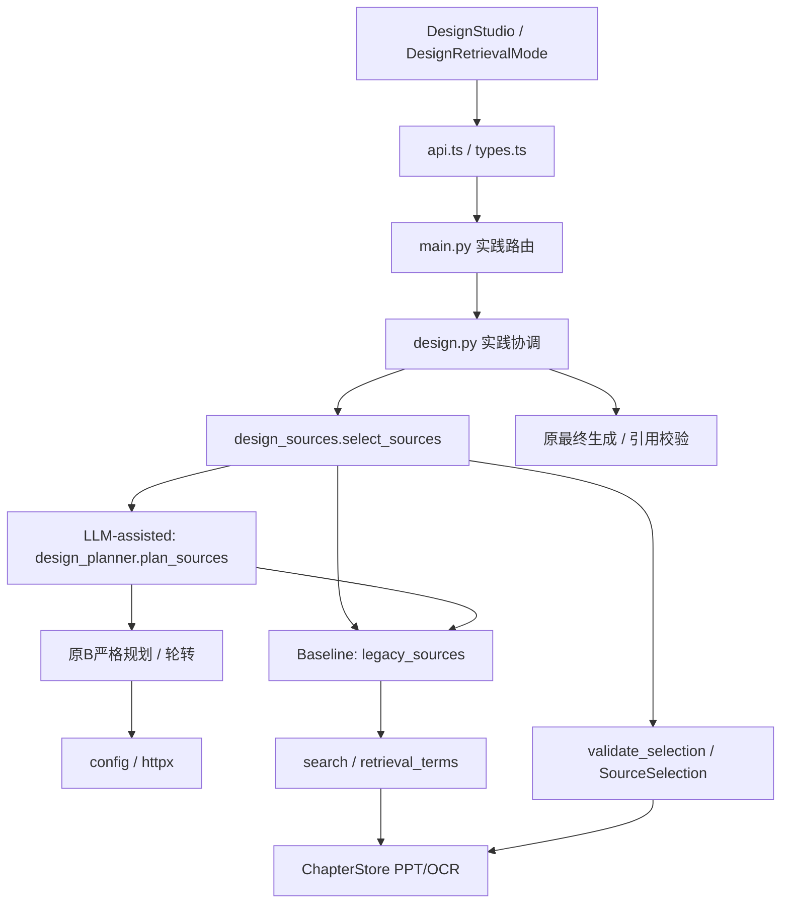
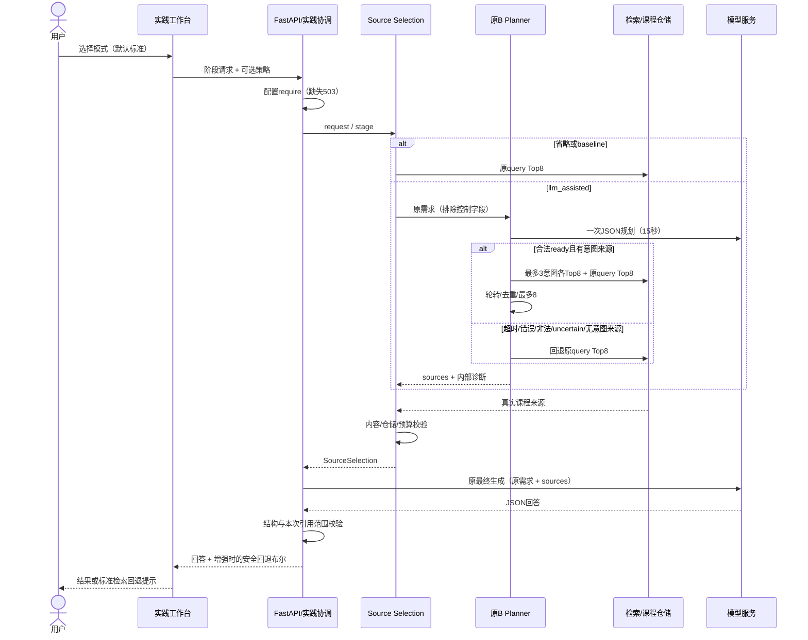

# P3T5 双策略集成记录

2026-11-17。用户已批准Baseline默认＋原始B显式可选；[ADR](phase3-final-architecture-decision.md)状态为Accepted — Conditional on Integration Validation。**P3T6独立验收待执行**，不是再次优化检索或证明B整体更优。

## 1. 版本与选择性移植

执行前iteration/jack / 2de30e162f834393c87a4d47d278f74e25072b28干净。只从原B4f878dcaa14a6d62a7f0506b866afe5fcd17f68d选择性移植design_planner.py及Mock测试，没有Merge/Cherry-pick整个实验分支。原A/C/B/B-v2/Coverage与Baseline worktree不动。

Planner与原B文本仅两处排除新retrievalStrategy控制字段；SYSTEM、iteration3-planner-v1、hash 920b836978fea8455fce4463861410c72585364928576173f30f5524c832b8b6、严格校验/目录、原轮转、15秒/1024输出token/一次无重试保持。控制字段不送模型，也不能作为原文evidence。没有B-v2 Prompt、Coverage选择、A规则或C重排。

## 2. 接口、默认与错误语义

三阶段请求增加可选`retrievalStrategy: baseline | llm_assisted`，省略默认baseline，未知值422。main路由仍调用原三阶段业务函数；业务只通过select_sources统一分派，没有自动路由或全局模型配置开口。

Baseline的legacy_sources/build_query/validate_selection函数AST与2de30e1完全相同；排序、数量、摘录、去重、Top8及默认0规划保持。所有模式最终生成仍需模型配置：入口require先执行，缺配置503，无来源422，最终生成失败502。增强回退不保证最终生成成功。

内部SourceSelection契约共享，queries/plan/usage/原始异常不进公开API。仅增强成功响应提供`retrievalFallback: boolean`；Baseline通过exclude_none省略新增状态，保持旧JSON形状。前端兼容旧响应字段缺失，并对出现的值做布尔校验。

## 3. Module View：静态职责



Baseline是已有函数，不是新框架。Planner不反向导入业务协调，公共检索/仓储不依赖实践策略。只有实践Request有策略枚举，普通问答/搜索/OCR/自测/大纲不增加开关。

## 4. C&C View：运行时交互



此图描述请求与网络通信，区别于静态模块图。标准来源不规划，但最终生成仍调用模型。增强每阶段独立，三阶段全选增强最多额外3次规划，另有原有最终生成调用；费用未知不能记0。

## 5. 前端行为与旧数据

select提供“标准检索（默认）”和“AI增强检索”；提示标准通常更快，增强可能更慢、不保证更准确、每次生成额外一次规划。三阶段均可选择，loading时禁用，配合原request ref防重复提交。

标准请求继续省略策略字段，增强明确发送llm_assisted。只影响下一次生成，不清空旧成果、不改变失效键；不同阶段可选不同模式。页面重新打开或清空项目恢复标准；模式和回退提示不持久化，不修改localStorage schema或旧数据加载。review保存剥离临时响应元数据，仅保留设计内容。

增强成功且retrievalFallback=true时提示“增强规划不可用，已使用标准检索。”不显示内部原因。最终生成失败仍走原安全错误提示。原确认替换、保存失败、取消和迟到响应保护保持。

## 6. 变更与架构符合性

后端：models/main仅目标请求枚举、响应布尔及省略空值；design_sources统一分派；contracts扩展内部诊断；design_planner原B移植；design.py只附成功回退状态。最终生成Prompt、_complete_json和引用函数AST不变。

前端：DesignRetrievalMode新局部控件，DesignStudio/api/types/studio.css最小接线，无复杂全局设置。新增原B故障测试、三阶段策略API测试、UI/参数/加载/失败/旧草稿/安全元数据测试。无新依赖或循环，公共search/retrieval_terms/仓储/问答/自测不改。静态核验在data/verification/p3t5-static.json。

## 7. 本轮实际验证

- 最终完整后端及所有评估工具 **259 passed**，1条既有Starlette/httpx弃用警告，32.89秒。包含默认三阶段与旧来源等价、显式baseline零Planner、增强正常/故障、422枚举、缺配置503且零规划、最终生成502不被回退掩盖、真实性/去重/Top8/取消、原Prompt/hash。
- 前端全量 **152 passed**；最后临时状态保存调整后，DesignRetrieval/DesignStudio **27 passed**，最终生产构建通过。
- 行数器自身2项通过；手写文件无超限，git diff检查通过。
- 新增API/UI测试全部Mock，本轮真实模型调用0；未运行本轮Chrome E2E、真实服务端到端、旧20条真实检索评测或远端CI。不能把历史通过当本轮验收。

复现（全新basetemp，不覆盖.env/结果）：

```powershell
$env:PYTHON_DOTENV_DISABLED='1'
Remove-Item Env:LLM_API_KEY,Env:LLM_MODEL,Env:LLM_BASE_URL -ErrorAction SilentlyContinue
& 'D:/app_install/miniconda/envs/maga/python.exe' -m pytest server/tests scripts -q --basetemp data/verification/<全新临时目录>
npm.cmd --prefix web test
npm.cmd --prefix web run build
node --test scripts/check-file-lengths.test.mjs
node scripts/check-file-lengths.mjs
git diff --check
```

提交范围仅本轮生产接线、测试、决策及架构说明，以包含本文的主线提交为交付索引。接口/UI/文档相互依赖，可作一个完整原子提交；无实验分支Merge或Push，旧历史及原始数据保留。

## 8. P3T6独立验收待办

1. Chrome核验默认/增强的分析→战术→评审流程、回退提示、loading/停止/迟到/失败/旧成果/保存失败，先确认Vite和后端服务身份。
2. 在明确新调用预算后验证实际模型规划与最终生成，引用充分性和Token/费用分别记录，不以Mock代替真实教学效果。
3. 真实PPT/OCR默认排序/摘录及增强Top8；旧20条关键词、问答/搜索/自测不污染；不把页图当视觉理解。
4. 网络超时/非法规划/服务不可用/取消和最终生成故障联调；默认无额外规划；真实取消后的后台生命周期及上游计费目前未证。
5. 完整后端/前端/build/Chrome及必要CI，记录实际集成HEAD，决定是否关闭Conditional状态。本轮未宣布这些验收通过。

P3T5执行到此停止，不再优化检索、不增加策略、不自动开始P3T6真实调用。
