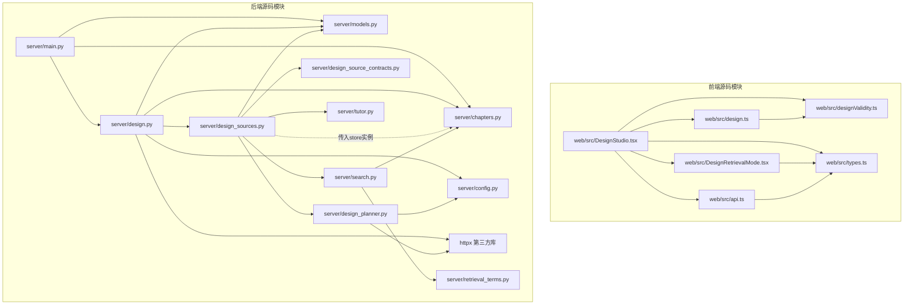
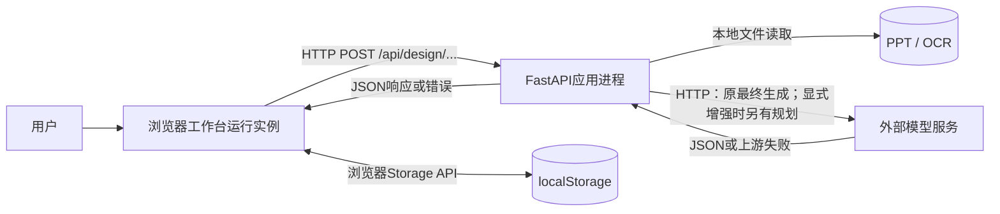
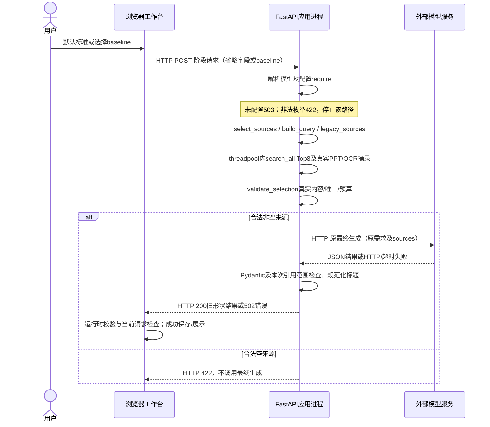
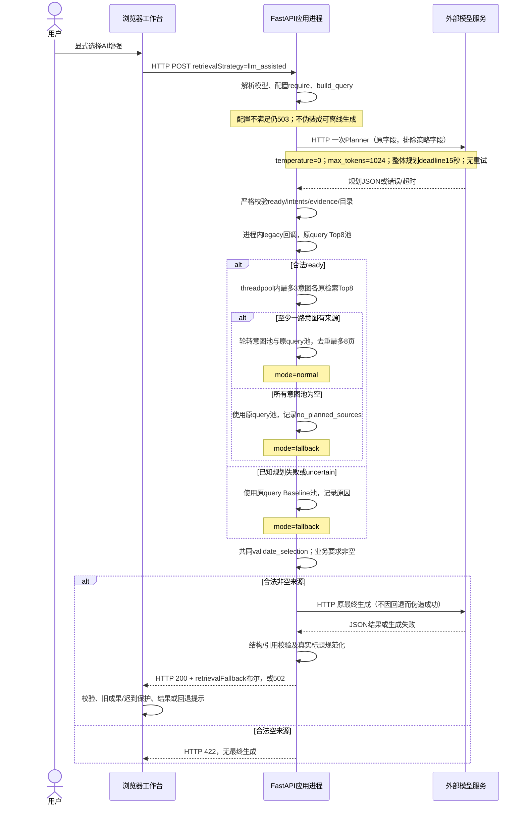

# P4T2：架构设计规范化与视图

日期：2026-11-17。静态核对基线：`iteration/jack` / `c6ee1dcaa87321f97948015e8cec021b10f6ad62`，工作区起始干净。本轮仅新增/更新文档，不运行产品测试、真实模型或算法实验。
最终生产决策仍是 **Baseline 默认＋原始 B 用户显式可选**；[ADR](./phase3-final-architecture-decision.md) Accepted，[P3T6裁定与复验](./phase3-final-acceptance.md) Gate PASS。未采用A/C/B-v2/Coverage的生产算法。

## 1. 范围、系统上下文与理论口径

MAGA在单用户本地学习场景中，采用React/TypeScript浏览器前端＋FastAPI模块化单体；实践三阶段依次生成质量属性/场景、架构战术、形成性评审。课程知识来自本地PPT正文、表格、备注及OCR；无数据库、账户、云同步、向量库或PDF全书索引。页图用于阅读，不代表模型理解视觉布局。
本次只规范需求→来源→原最终生成这一变化，问答/自测/全书搜索只作为必须保持的共用边界。完整材料入口见[证据索引](./phase4-evidence-index.md)。

重要陈述分为三层：

|层次|含义|本文示例|
|---|---|---|
|Design Intent（I）|希望满足的性质及取舍，不自动等于达标|自然需求获得互补课程知识，同时不让所有用户承担规划成本|
|Implemented Mechanism（M）|当前源码实际机制，本轮静态核对|默认枚举、显式分派、一次Planner、真实来源出口及原最终生成|
|Verified Evidence（E）|此前特定版本/环境实际执行结果，本轮只读复核|P3T6真实2增强/1降级/0失败；不能解释成长期成功率|

**Structure**是实际元素及关系；**View**按特定关注点表达某类结构。Module Structure描述代码单元及依赖；C&C Structure描述执行中组件及连接，二者不是一一对应。
**Pattern**是可复用的设计解决方案，不能把每张图或每个结构称为模式；**Style**描述一类系统的组织约束。模块化单体/浏览器–服务端是本系统组织方式，三阶段流程本身不是新架构模式。
**Tactic**是影响质量属性响应的设计选择；具体校验/超时/回退也可准确称“机制”，不强行归入某一经典战术名录。Strategy是设计模式，与架构视图类别及Graceful Degradation机制分开。

## 2. Architectural Drivers

Driver是显著影响职责、依赖、接口或重大取舍的需求/约束，不是所有功能清单。优先级依据[P1主任务](./phase1-task-definition.md)、[P2 §4](./phase2-analysis.md)和[最终ADR](./phase3-final-architecture-decision.md)：适用性最高、可追溯性必须保持有历史依据；其余“高/支持”是**本次总结性归纳**，不伪装成历史批准的数字排名。

|ID / Driver|Source|Architectural Significance|Priority及依据|Design Consequence（I→M）|Evidence（E/静态）|
|---|---|---|---|---|---|
|D1 自然需求匹配 / Functional Suitability|P1主任务；N01/N02根因|决定是否需要需求到检索输入的转换，以及谁负责证据供给|最高：历史明确|不只保证页码合法；比较词法/规划/选择责任，最终允许局部语义增强|[根因/候选](./phase2-analysis.md)、[统一结果](./phase3-evaluation-results.md)|
|D2 默认性能与低额外开销|P2 Q3；ADR用户主动承担增强代价|若全面采用B，会把网络规划及多次本地检索成本施加给全部请求|高：P2性能重要；默认优先为归纳|Baseline继续默认，省略策略零Planner；不承诺固定秒级SLA|[分派](../../server/design_sources.py)、[默认测试](../../server/tests/test_design_strategy.py)、[验收](./phase3-final-acceptance.md)|
|D3 可信来源与业务连续性 / Reliability|P2 Q2、B故障矩阵；P3T6裁定|模型不可信且可失败，必须区分规划失败、来源违约与最终生成失败|必须保持：真实来源/错误语义；可靠性高为归纳|严格计划与来源检查，已知规划异常回退，最终生成仍可失败，不伪造成功|[契约](./phase2-implementation-contract.md)、[Planner](../../server/design_planner.py)、[裁定测试](../../server/tests/test_acceptance_adjudication.py)|
|D4 变化局部化 / Modifiability|P2共享搜索影响分析；三个独立候选|不能为实践改动波及搜索/问答/自测；需要稳定来源契约|高：保持共用行为的架构约束|实践专属select_sources，SourceSelection隔离上游策略与下游生成|[开发边界](./phase2-implementation-contract.md)、[集成](./phase3-dual-strategy-integration.md)、[静态复验工具](../../scripts/acceptance-conformance.py)|
|D5 可维护/可测试 / Maintainability & Testability|P2机制隔离、单文件≤500、工程证据要求|过大框架与隐式组合降低归因、复现和故障定位能力|支持性驱动：本次归纳，不与D1同级|小模块、确定性合并、transport注入、独立测试，原型分支保留|[共同基点](./phase3-experiment-base.md)、[Planner测试](../../server/tests/test_design_planner.py)、[集成文件范围](./phase3-dual-strategy-integration.md)|
|D6 外部LLM依赖与调用成本|B规划网络预算、最终ADR人工取舍|增加失败点/延迟/Token支出，影响默认选择、超时和操作可观察性|高成本约束：归纳；只在主动增强时承担是人工决策|复用配置，不增加服务；一次无重试、15秒、1024Token/3意图，未知费用null|[Planner](../../server/design_planner.py)、[真实记录](../../data/verification/p3t6-acceptance-20261117-v1/real-summary.json)、[ADR](./phase3-final-architecture-decision.md)|

## 3. Constraints、优化目标与可接受代价

|类别|约束/目标|代码或决策核对及边界|
|---|---|---|
|必须满足C1|来源0–8、不同真实课程页；生成须非空|[SourceSelection](../../server/design_source_contracts.py)及[validate_selection](../../server/design_sources.py)检查页号/标题/摘录/去重；合法空来源进入业务返回422，不凑页|
|必须满足C2|保持API/旧成果/原最终生成|[models](../../server/models.py)默认baseline；非法枚举422；[design](../../server/design.py)原Prompt/引用校验；[工作台](../../web/src/DesignStudio.tsx)不持久化检索策略|
|必须满足C3|本地课程、现有模块化单体，不引入新基础设施|[ChapterStore](../../server/chapters.py)、[历史ADR-001–004](../archive/spec/architecture.md)；没有新数据库、Embedding服务或Agent框架|
|必须满足C4|默认路径额外Planner调用0；仅显式llm_assisted启用B|[select_sources](../../server/design_sources.py)；普通默认生成仍调用原最终LLM，不能称全流程零模型成本|
|必须满足C5|规划失败有界降级，不能掩盖其他失败|[plan_sources](../../server/design_planner.py)只处理已知规划异常；配置require仍503，空来源422，最终生成502；仓储/代码/预算违约不包装成功|
|希望优化G1|相关性下界及必要知识覆盖|KC8/P8下界是评价度量，无“每查询必须提升”的历史阈值；不完整标注不能证明所有来源无关|
|希望优化G2|可修改、可复现、控制性能代价|统一契约与隔离为机制，不承诺所有未来替换均零传播或更快|
|接受的代价A1|主动增强增加网络规划、本地多路检索、UI/API与测试维护|[B2 ADR](./phase3-final-architecture-decision.md)已批准；可能回退，增强不保证优于默认|
|未证明U1|普遍教学收益、生产P95/吞吐、长期可靠性/可用性、货币上限|既有小样本和Token记录不足；不能事后补一个阈值再宣布达标|

“外部模型失败必须安全回退”在此特指**新增Planner**的已知失败；最终生成失败必须明确报错并保护成果，不存在备用模型或离线伪回答。

## 4. 标准六要素Quality Attribute Scenarios

以下六个场景是基于现有任务的总结性规范表达，不新增产品承诺。每个Response Measure分别说明契约要求、历史实测及达标范围；E均来自历史执行，本轮未重跑。

### QAS-01 自然语言知识匹配（D1、D3）

|六要素|场景定义|
|---|---|
|Source of Stimulus|提出软件设计需求的学生|
|Stimulus|以自然语言描述系统和约束，可能没有课程术语或包含多个必要知识|
|Environment|固定7章PPT/82份OCR、指定标签版本和来源预算，比较时不进行最终生成|
|Artifact|需求→查询→检索→已校验来源链|
|Response|保留原需求，供给有课程依据的相关页，供后续生成使用；不以非空结果宣称证据充分|
|Response Measure|测KC8、P8下界、遗漏知识/未审页及真实唯一来源≤8；没有预设覆盖提升阈值，不判“全面优于Baseline”达标|

I：改善匹配；M：[原查询/规划多路与出口](../../server/design_sources.py)；E：[P3T3协议](./phase3-evaluation-protocol.md)与[结果](./phase3-evaluation-results.md)下开发KC Baseline50.00%、B63.64%，保留33.33%、50.00%，B保留1升1降1平；[后续新测试](./phase3-b-v2-experiment.md)Baseline/B均66.67%。这些集合不得合并或跨批混算。
限制：AI构建标签、P8仅下界、有限保留样本；N13的6:15后续审核表明“未命中冻结检测标签”不等于完全没有检测知识，详见[Coverage §4](./phase3-b-coverage-experiment.md)。不证明最终回答或学习效果。

### QAS-02 默认检索性能与旧接口（D2、D6）

|六要素|场景定义|
|---|---|
|Source of Stimulus|默认模式用户或不带新增字段的旧客户端|
|Stimulus|提交一次合法实践阶段请求，省略retrievalStrategy或显式baseline|
|Environment|模型配置有效、课程可访问；有旧客户端及已存在成果|
|Artifact|请求模型、来源分派、原Baseline选择与业务返回|
|Response|走原查询与legacy_sources，额外Planner调用0；使用原最终生成和响应结构|
|Response Measure|每请求Planner=0；同输入省略/显式baseline的完整来源字典一致；默认响应不新增retrievalFallback；记录来源选择wall但无预设秒级SLA|

I：普通用户不承担新增规划成本；M：[请求默认值](../../server/models.py)、[legacy与分派](../../server/design_sources.py)、[response_exclude_none路由](../../server/main.py)。E：[三阶段参数化默认测试](../../server/tests/test_design_strategy.py)及[P3T6](./phase3-final-acceptance.md)Chrome默认三阶段0 Planner、3次最终生成；旧来源等价检查通过。
性能历史值：[P3T3](./phase3-evaluation-results.md)Baseline开发平均入口到已校验来源4.259秒，保留3.969秒；这是当时同机暖测口径，不是当前生产SLA，也不能与完整生成时间比较宣称提速。

### QAS-03 显式增强与调用资源边界（D1、D2、D6）

|六要素|场景定义|
|---|---|
|Source of Stimulus|主动接受额外代价的学生|
|Stimulus|选择AI增强并发送retrievalStrategy=llm_assisted的阶段请求|
|Environment|模型/课件可用；仅实践路径，当前页面策略为临时状态|
|Artifact|工作台/API、原B Planner与多路词法来源选择|
|Response|原需求排除控制字段送一次Planner；合法ready意图各取原检索Top8，加原query池后轮转去重，出口校验，再进行原最终生成|
|Response Measure|每阶段规划≤1次且无重试；ready 1–3意图；max_tokens=1024，内容≤8000字符；规划deadline=15秒；0–8真实唯一页；成功增强响应retrievalFallback=false；记录usage/耗时，费用未知null|

I：有界语义规划；M：[Planner SYSTEM/validate_plan/merge_sources](../../server/design_planner.py)、[选择UI](../../web/src/DesignRetrievalMode.tsx)。E：[Planner与API测试](../../server/tests/test_design_planner.py)、[策略测试](../../server/tests/test_design_strategy.py)；[历史真实记录](../../data/verification/p3t6-adjudication-20261117-v1/adjudication.json)场景分析/战术均normal、3意图、8真实页，分别完成对应生成。
限制：1024是请求的输出上限参数，不是输入/费用上限；推理Token可能占满输出预算。15秒不包括后续本地检索、校验、最终生成；本地旧查询在成功与失败路径都会执行。无新规划持久缓存、自动路由或模型重试。

### QAS-04 Planner故障降级（D3、D6）

|六要素|场景定义|
|---|---|
|Source of Stimulus|外部规划模型服务或其不可信输出|
|Stimulus|超时、HTTP/连接错误、非法JSON/字段/证据、uncertain或计划查询没有来源|
|Environment|显式增强；最终模型配置有效，Baseline仍有真实来源，后续生成可完成|
|Artifact|规划异常边界、Baseline回退、公共校验、公开回退提示|
|Response|保留稳定原因码，回原query来源，校验后继续原最终生成；只有成功业务才返回retrievalFallback=true，不将其统计为增强成功|
|Response Measure|上述条件下业务200、回退来源与legacy一致、Planner≤1且不重试、前端显示回退提示；15秒是规划截止条件，非总业务时限；回退或生成失败不得算成功|

M：[异常分类/回退](../../server/design_planner.py)、[业务元数据](../../server/design.py)、[UI提示](../../web/src/DesignRetrievalMode.tsx)。E：[五类API结果测试](../../server/tests/test_acceptance_adjudication.py)、[deadline/取消测试](../../server/tests/test_design_planner.py)及[验收第11节](./phase3-final-acceptance.md)：真实工作流Enhanced Success=2、Degraded Success=1、Failure=0；评审Planner length/空输出、最终业务200，未把降级算增强。
原[FAIL结果](../../data/verification/p3t6-acceptance-20261117-v1/chrome-real/results.json)来自三阶段必须全部normal的额外断言，保留证据后经用户裁定与针对性复验成为PASS；不是抹去规划失败。限制：正常回退仍需Baseline来源和最终模型，仓储违约/无来源/最终生成失败继续可见；不是无条件高可用保证。

### QAS-05 来源策略的修改局部化（D4、D5）

|六要素|场景定义|
|---|---|
|Source of Stimulus|维护来源选择链的开发者|
|Stimulus|在既有契约下修改/替换实践来源策略，不改下游业务语义|
|Environment|开发维护阶段，公开API、SourceSelection、共享搜索与最终生成需稳定；策略代码在独立实验分支验证|
|Artifact|来源分派/策略模块、内部契约及调用方依赖|
|Response|将变化封装于实践来源职责和必要接线，保持最终生成、共享检索及旧请求；通过共同出口拒绝违约策略|
|Response Measure|比较冻结版本文件/函数差异；共享搜索/课件/问答/自测和最终生成Prompt不变，公共来源契约测试通过；没有预设修改工时或“零文件传播”阈值|

M：[统一契约](../../server/design_source_contracts.py)、[分派/回调边界](../../server/design_sources.py)。E：[P3T5文件边界](./phase3-dual-strategy-integration.md)及[已有conformance](../../data/verification/p3t6-adjudication-20261117-v1/conformance.json)：17项静态断言，包括原B仅排除策略字段、旧函数/公共检索未变；[来源测试](../../server/tests/test_design_sources.py)验证真内容/去重/预算违约拒绝。
限制：这证明本轮变化受控，不证明任意新策略无需改动API、Prompt或测试；新增枚举会涉及前后端。现有实现没有插件注册器或完全独立可替换的策略对象族。PPT不得将“无需整体重构”写为“零维护成本”。

### QAS-06 旧业务兼容与成果保护（D3、D4、D5）

|六要素|场景定义|
|---|---|
|Source of Stimulus|使用旧草稿的用户，及异步失败/迟到的网络请求|
|Stimulus|刷新、切换检索模式、重生成、停止、重试或前后请求完成次序变化|
|Environment|浏览器已有合法旧成果，可能存在进行中请求；localStorage可用，保存失败另按既有机制提示|
|Artifact|DesignStudio状态、AbortController/request引用、有效性键与本地成果存储|
|Response|模式仅影响后续生成且刷新复归baseline；失败/取消不覆盖旧成果，丢弃迟到响应；成功且保存允许才替换成果；不持久化策略/回退元数据|
|Response Measure|失败/取消后保存JSON不变；新请求成功后旧请求晚到不能覆盖新成果；加载时模式/生成操作禁用且重复点击不增加Planner；旧草稿无需schema迁移；非法枚举422|

M：[DesignStudio](../../web/src/DesignStudio.tsx)、[存储](../../web/src/design.ts)、[有效性键](../../web/src/designValidity.ts)、[API校验](../../web/src/api.ts)。E：[DesignRetrieval测试](../../web/src/DesignRetrieval.test.tsx)、[DesignStudio测试](../../web/src/DesignStudio.test.tsx)、[历史Chrome API替身流程](../../web/e2e/studio.spec.ts)及[P3T6裁定复验Chrome结果](../../data/verification/p3t6-adjudication-20261117-v1/chrome-mock/results.json)17组通过，涵盖切换、五类生成故障和取消/迟到；相关后端68项通过有独立记录。
限制：浏览器Abort与迟到保护不等于后端/上游立即停止；本次已观察旧后端任务可继续。未证明停止后不再计费；不能从前端无污染推断端到端任务生命周期已取消。

## 5. Module View：静态uses/import结构

**Viewpoint**：维护者与实现审查者；关注策略变化传播、配置与生成边界、文件职责是否真实。元素是实际源码模块（文件），框是同一侧的代码分组，不表示进程或部署单元；实线表示静态import依赖，虚线表示传入对象的uses依赖。图为关键依赖子集，不罗列所有样式/类型及辅助组件。

前后端间没有源码import箭头，HTTP交互在下一视图表达。图未把“Baseline Selector”“LLM Selector”“Validator”“最终生成器”伪装成独立文件：

|实际文件/元素|职责与封装边界|关系及重要约束|
|---|---|---|
|[DesignStudio](../../web/src/DesignStudio.tsx)、[Mode](../../web/src/DesignRetrievalMode.tsx)、[api](../../web/src/api.ts)|页面临时选择、请求/取消/消费结果；Mode仅受控UI，网络在api|不暴露模型密钥或任意模型参数；旧存储模型不加策略偏好|
|[main](../../server/main.py)、[models](../../server/models.py)|组装三路POST、注入同一ChapterStore，解析枚举与默认值|scenarios/tactics/review使用相同策略字段；未知值422；缺配置由业务require处理|
|[design](../../server/design.py)|三阶段协调、原最终生成HTTP和结构/引用规范化；这些职责都在同一模块|先require，再select_sources；合法非空才生成；没有单独部署的生成服务模块|
|[design_sources](../../server/design_sources.py)|build_query、分派、Baseline legacy_sources、validate_selection均在此文件|Baseline与增强均经同一出口；把legacy_sources作为callable传给plan_sources，避免Planner反向import造成循环|
|[design_planner](../../server/design_planner.py)|LLM-assisted来源选择协调、Planner请求/校验、多路检索调度、merge_sources在同一文件|用传入legacy回调检索；并非另有独立“增强Selector文件”和“Planner服务”|
|[内部契约](../../server/design_source_contracts.py)|Source/SourceDiagnostics/SourceSelection，稳定结果形状|diagnostics仅内部；公共响应只在增强成功业务返回安全retrievalFallback布尔|
|[search](../../server/search.py)、[terms](../../server/retrieval_terms.py)、[chapters](../../server/chapters.py)、[excerpt](../../server/tutor.py)|共享词法搜索、术语、PPT/OCR访问、摘录|共用层不import实践策略；合法性以真实仓储为准；没有评估fixture生产映射|
|[config](../../server/config.py)、httpx库|配置和网络依赖|Planner复用配置/协议而非调用server/llm.py通用网关；最终生成HTTP也在design.py，不画虚构共享网关|

变化边界是分派和内部契约。threadpool属于本后端进程中的执行设施，不是消息队列或独立服务；传入transport是既有测试替身接缝，不是生产策略的任意模型选择入口。

## 6. C&C View：运行时组件与连接

**Viewpoint**：运行/集成与故障分析；关注两种请求路径、外部调用次数、进程内协作、失败如何返回。元素是浏览器工作台、单个后端应用进程、外部模型服务和本地资源。后端内部角色在时序中用同一Backend参与者的自调用表示，绝不表示独立服务。
连接类型：浏览器↔后端为HTTP JSON；后端↔模型为HTTP chat/completions（实际服务用HTTPS）；后端内为函数/协程调用及threadpool工作；PPT/OCR与localStorage是本地资源访问。开发时浏览器API经Vite代理到FastAPI，代理不是新的业务组件。

实现映射：[浏览器工作台](../../web/src/DesignStudio.tsx)、[HTTP客户端](../../web/src/api.ts)、[应用工厂](../../server/main.py)、[课件存储](../../server/chapters.py)、[业务生成](../../server/design.py)、[规划](../../server/design_planner.py)。模型服务不是本项目源码模块，多个模型调用通常复用相同配置，不表示两个不同供应商服务。

### 流程A：Baseline（每个业务阶段一次）

约束：[select_sources](../../server/design_sources.py)默认路径没有Planner；[design](../../server/design.py)仍调用原最终生成。源码/仓储违约是可见失败，不进入“合法非空”成功分支，也不伪装为空结果。前端对失败或已取消/过期响应不替换旧成果。

### 流程B：原B显式增强与规划失败回退

只有合法ready才尝试意图池，试完发现均空才回退；实际顺序先得到原query池，再检索各意图，见[plan_sources](../../server/design_planner.py)。0–8/真实内容违约或仓储错误不由Planner异常表吞掉。一次增强成功阶段通常2次外部HTTP（规划＋生成），默认阶段1次；最终生成失败不再次规划。

## 7. Before / After与演进依据

|变化关注点|原始单一Baseline|最终双策略|保留边界与证据|
|---|---|---|---|
|用户入口|无来源策略字段/UI选择|baseline默认，llm_assisted显式选择|只影响后续生成、不持久化模式；[集成](./phase3-dual-strategy-integration.md)|
|来源职责|design._sources组织原检索|先P3T1提取统一入口，再P3T5加入原B分派|legacy/build_query/出口与共享检索保持；[基点](./phase3-experiment-base.md)|
|规划与失败|无额外Planner|可选严格Planner、轮转与有界回退|默认仍零Planner；最终生成失败不被回退掩盖|
|下游|既有三阶段生成与引用检查|仍共享同一生成代码与真实来源契约|没有新生成算法、API大重构或数据库|
|生产纳入|原Baseline|只选择性移植原B必要代码|A/C/B-v2/Coverage只保留实验分支，不整体Merge|

实际链条：P1发现问题→P2比较设计→c6fc185共同基点→A/B/C实验及补充反证→B2人工双策略批准→0a91d63选择性集成→9b6b1ea首次FAIL→f58b6c9裁定复验PASS。
不是最初已经确定双策略，也不是将多个候选合成最优策略；各commit及只读定位命令见[索引Git表](./phase4-evidence-index.md)。

## 8. Architectural Tactics / Mechanisms映射

本表为机制和作用因果，不提前完成P4T3全方案ATAM排序。关于Availability的表述限于规划子功能的可降级与业务连续性，不等同于整体系统可用率承诺。

|ID / Tactic或准确机制名|作用的质量属性 / Decision|Implementation（M）|Verification（E，历史）|Cost / Risk|
|---|---|---|---|---|
|T1 Encapsulate Change / 局部化来源变化|Modifiability，D4；策略变化经共同入口|[design_sources](../../server/design_sources.py)、[SourceSelection](../../server/design_source_contracts.py)|[共同出口测试](../../server/tests/test_design_sources.py)、[既有conformance](../../data/verification/p3t6-adjudication-20261117-v1/conformance.json)|仍需维护枚举/UI/API及策略专属测试，不是所有修改零传播|
|T2 Separation of Concerns（职责原则）|Maintainability/Testability，D5；规划不认证来源、不负责最终教学生成|[Planner](../../server/design_planner.py)、[协调/生成](../../server/design.py)、[仓储](../../server/chapters.py)|[集成文件核对](./phase3-dual-strategy-integration.md)、[Planner测试](../../server/tests/test_design_planner.py)|Planner模块内部仍合并网络/规划校验/检索协调，不宣称已拆成独立服务或单职责类族|
|T3 Input/Output Validation（边界校验机制）|Reliability/可信性，D3；拒绝无效计划和伪造引用|Pydantic、[validate_plan](../../server/design_planner.py)、[validate_selection](../../server/design_sources.py)、[引用校验](../../server/design.py)、[前端api](../../web/src/api.ts)|[来源违约测试](../../server/tests/test_design_sources.py)、[裁定故障测试](../../server/tests/test_acceptance_adjudication.py)|严格evidence/目录会回退；结构合法和原文子串不证明语义正确，定位合法不证明论据充分|
|T4 Timeout / Bounded Resource Usage|Performance/Reliability/调用成本，D2/D6；避免新增规划无限等待或分叉|[asyncio.timeout(15)、一次/1024/3意图](../../server/design_planner.py)；来源≤8|[deadline测试](../../server/tests/test_design_planner.py)、[真实空输出及Token](../../data/verification/p3t6-acceptance-20261117-v1/real-summary.json)|deadline不含检索/最终生成；预算可能被推理消耗；最终生成原httpx 60秒超时不等于全业务总deadline|
|T5 Graceful Degradation / 合法规划失败回退|Reliability/Business Continuity，D3；可选能力失败仍用原来源|[plan_sources原因码/原query回退](../../server/design_planner.py)、[安全回退标记](../../server/design.py)|[P3T6真实2/1/0](./phase3-final-acceptance.md)、[Mock故障表](../../server/tests/test_acceptance_adjudication.py)|失去增强语义，仍可能重复本地工作；依赖Baseline和最终模型可用，不保证所有业务成功|
|T6 Error Detection / Typed Exception Handling（软件故障识别机制）|Reliability/可操作性，D3；识别有限异常后决定回退或报错|[HTTP状态/超时/非法结构分类](../../server/design_planner.py)、[生成502](../../server/design.py)|[Planner失败测试](../../server/tests/test_design_planner.py)、[回退失败/来源500/生成502](../../server/tests/test_acceptance_adjudication.py)|无健康探针、心跳服务、熔断或自动重试；课程“故障检测”内容不是本系统实现了心跳检测|
|T7 显式选择＋稳定默认（产品/架构选择机制）|Performance/成本隔离，D2/D6；用户主动承担增强代价|[Request枚举](../../server/models.py)、[UI](../../web/src/DesignRetrievalMode.tsx)、[分派](../../server/design_sources.py)|[三阶段默认/增强测试](../../server/tests/test_design_strategy.py)、[Chrome复验](../../data/verification/p3t6-adjudication-20261117-v1/chrome-mock/results.json)|增加状态组合；用户可能误以为增强必然更好，需要现有提示|
|T8 请求身份/迟到保护与先保存再替换（状态保护机制）|Reliability，D3；失败/取消不破坏旧成果|[request ref、AbortController、commit](../../web/src/DesignStudio.tsx)|[工作台测试](../../web/src/DesignStudio.test.tsx)、[Chrome取消/迟到](../../data/verification/p3t6-adjudication-20261117-v1/chrome-mock/results.json)|保护UI不等于取消远端任务或计费；localStorage非跨设备/事务数据库|

### Strategy Pattern结构特征及模块化单体的作用

存在Strategy-like特征：共同目标“来源选择”、可选择的两种实现路径、稳定结果契约、业务调用者不直接组织各路检索。但实际是字面量枚举＋函数分派，Baseline还位于分派模块，增强经注入legacy回调复用基点；没有Strategy接口类、对象注册/替换体系。
因此准确描述为**具有策略选择特征的函数式分派**，不宣称已完整实现GoF Strategy类结构，更不称新的Architectural Pattern。
原模块化单体让变化可在同一后端局部接线、复用仓储/配置/测试注入，无需分布式部署；代价是同进程资源和故障影响仍共享，不能声称服务级隔离或独立扩缩容。

## 9. 理论—实现—验证追溯与一致性检查

|理论/陈述|Driver→QAS→机制|核对入口/证据|本次结论|
|---|---|---|---|
|自然需求匹配|D1→01/03→原查询与可选规划|[根因](./phase2-analysis.md)、[实验](./phase3-evaluation-results.md)、[新测试](./phase3-b-v2-experiment.md)|部分例改善，非普遍优势；目标与验证分开|
|默认无额外规划|D2/D6→02→T7|[默认代码](../../server/models.py)、[参数化测试](../../server/tests/test_design_strategy.py)|静态与历史运行相符；零Planner≠零最终模型|
|规划可降级|D3→04→T3–T6|[异常边界](../../server/design_planner.py)、[真实裁定](./phase3-final-acceptance.md)|Enhanced/Degraded分别统计，原FAIL保留，最终PASS不消除模型失败|
|修改局部化|D4/D5→05→T1/T2|[静态文件与契约](./phase3-dual-strategy-integration.md)、[conformance](../../data/verification/p3t6-adjudication-20261117-v1/conformance.json)|实际函数/模块映射，不以角色图虚构模块拆分|
|兼容与成果保护|D3/D4→06→T7/T8|[浏览器状态](../../web/src/DesignStudio.tsx)、[验收](./phase3-final-acceptance.md)|模式临时、loading限制和迟到保护成立；服务端取消未获同样保证|
|图示校正|Module uses / C&C运行时|[旧集成图](./phase3-dual-strategy-integration.md)、当前源码|旧图作概览未必是代码缺陷；本图明确同文件职责、回调、HTTP和进程内边界，不修改代码迎合图|

与历史材料的表达差异：

- 早期根因/候选文档中的B确定性建议、Proposed或待验收状态属于当时记录，最终以后续LLM原B、B2批准和Accepted ADR为准。
- “所有外部LLM失败都回退”过宽：仅规划已知失败适用；“15秒返回业务”与“总成本有界”也超出实际机制。
- 原B实现未通过server/llm.py共享网关；不把逻辑规划/合并/生成角色画成三个部署服务。
- 本文不改变历史标签；N13的6:15为后续审核限定，旧KC表仍在各自冻结口径下保留。

## 10. 已验证边界、未验证性质与剩余限制

E来自不同版本/范围，不能把测试数相加当覆盖率。P3T6首次全后端/工具259、前端152、Chrome API替身25；裁定复验规则9、相关后端68、Chrome真后端Mock模型17组，都是历史记录，不是本轮重新执行。
三类证据始终区分：Chrome＋Mock API；Chrome＋真实后端＋Mock模型；Chrome＋真实后端＋真实模型。真实模型历史只有一个三阶段工作流，2增强/1降级，6次HTTP，25,853 Token，费用null；裁定复验新增真实调用0。

尚无独立人工金标准/完整页相关性、长期学习收益、生产负载/吞吐/P95、长期外部模型可靠性、可靠货币总费用、浏览器断连后远端取消保证。
P8下界和KC8只在各批标签下解释；B-v2新测试退化、Coverage固定池0升2降40平不支持稳定净收益，不能用功能测试替它们证明优化成功。
QAS中的来源真实性是页/标题/摘录及本次引用的合法性，不是语义溯源认证；页图/OCR不能解释为模型理解布局箭头。

## 11. P4T3交接：分析输入，不在本轮完成ATAM复盘

|类型|本轮定位的高价值材料|P4T3边界|
|---|---|---|
|Sensitivity候选|Top8及每路预算、Prompt词法落点、目录边界、15秒/1024Token、校验严格性；见QAS03/04、T3/T4|分别指出影响的质量属性及证据，不把尚未做的消融当因果已证|
|评价敏感性|N14概览/机制口径、N13 6:15漏标、P8下界；[审核](./phase3-decision-evidence-review.md)、[Coverage更正](./phase3-b-coverage-experiment.md)|与架构参数Sensitivity分开，不追改旧标准或重算新赢家|
|Tradeoff候选|规划局部收益vs网络/本地重复检索成本；严格校验vs回退；显式双策略vs接口/状态维护；见T1–T8|需基于同批配对与场景汇总，不跨日期wall宣称提速|
|Risks|Token推理耗尽、查询漂移、来源不足、外部依赖、未知费用、后台继续；见QAS限制|区分已观察事件、合理推断和未测风险，不预设新策略方案|
|ADR复盘|[最终ADR](./phase3-final-architecture-decision.md)、[P3T6裁定](./phase3-final-acceptance.md)、第7节演进|解释人工接受的代价及未采纳候选，保留阶段建议与最终决定的区别|

本轮交付为本文及[索引更新](./phase4-evidence-index.md)，不改代码、Prompt、测试或历史数据，不增加模型调用，不Merge/Push。本轮完成后停止，不执行P4T3。

文档检查记录：本文146条、索引178条相对文件链接全部存在且大小写匹配，无本机绝对路径；6个QAS均具备六要素。4个Mermaid代码块的围栏、subgraph及分支配对经静态检查；Module图15条后端模块import边经Python AST核对。未安装图形工具、未进行Mermaid渲染，不能把静态结构检查称为渲染验收；图中其余前端依赖及注入uses边为源码定向核对。Git diff空白检查通过。
