# MAGA 第三轮迭代：最终架构实践报告

2026-11-18；报告核对基线 `iteration/jack` / `dd40c0597c3f3099e34c19eb2e39002ee45ca789`。本轮只整理材料和渲染视图，未重新运行算法实验、产品回归或真实模型。

## 1. Executive Summary

MAGA 是面向软件体系结构课程的本地 AI 教学助手。本轮聚焦架构实践工作台：学生提出自然语言设计需求后，系统能否向后续分析供给恰当的课程来源？诊断发现词法召回不足、通用词排序与 Top-8 截断两个不同机制。这涉及需求转换、证据供给、外部服务依赖与失败边界，不能只用一次搜索命中解释。[问题定义](./phase1-task-definition.md)、[根因](./phase2-analysis.md)。

从共同基点独立实现 A 词法优化、B LLM 规划、C 宽候选重排，经统一实验及 B-v2、B-Coverage 反证，发现原 B 只有局部覆盖收益，却增加延迟、Token 与外部依赖。最终人工批准 **Baseline 默认＋原始 B 手动可选**；选择性集成后，真实工作流得到 **2 Enhanced Success / 1 Degraded Success / 0 Failure**。原始 FAIL 保留，经人工裁定与针对性复验，当前 Gate PASS、ADR Accepted、Phase 3 完成。[ADR](./phase3-final-architecture-decision.md)、[验收第11节](./phase3-final-acceptance.md)。

本轮价值是形成有依据、可追溯的架构演进决策，未证明某算法全面最好、匹配问题已解决或长期教学效果改善。AI 构建标注、小样本、未知费用和上游取消风险仍限制结论。

## 2. System Context & Problem

系统采用 React/TypeScript/Vite 前端与 FastAPI 模块化单体。课程来源是本地 PPT 正文、表格、备注及 OCR，状态保存在浏览器 localStorage；无数据库、向量库、账号或云同步，PDF 未接入全书索引。页图可阅读，不意味着模型理解视觉关系。[功能边界](../FEATURES_AND_INTERFACES.md)。

用户填写标题、场景、需求约束，依次请求场景分析、战术推荐、形成性评审。原 Baseline 拼接业务字段，做词法检索，取最多8页真实来源及摘录，再调用最终生成模型。通用搜索、问答、自测与本轮来源选择并非同一条完整链路。

已复现的 N01 自然需求没有产生关键术语，相关页无正分；N02 已召回可用性定义页，但排第12，无法进入8页预算。“系统”可使12306案例得9分，高于定义页6分。后者是排序截断，不能仅靠术语是否存在解释，也不能推广为所有自然需求都失败。[原始查询贡献分解](./phase2-analysis.md)。本轮只演进实践证据供给，不重建完整 RAG 或最终生成。

## 3. Architectural Drivers & QAS

需求是改善课程知识匹配；质量属性定义如何评价；真实来源/API兼容等是必须保持的约束；提高覆盖、控制延迟是目标，并无事后补定的普遍提升阈值。

|沿用编号|驱动因素|对应 QAS 及架构后果|
|---|---|---|
|D1|自然需求匹配 / Functional Suitability|01自然知识匹配、03显式增强；比较需求转换与证据选择机制|
|D2|默认性能与低额外开销|02默认性能、03增强预算；不给全部请求增加 Planner|
|D3|可信来源与业务连续性|01、04故障降级、06成果保护；严格校验并区分失败层次|
|D4|变化局部化 / Modifiability|05修改局部化、06兼容；实践专属入口，共用稳定来源契约|
|D5|Maintainability / Testability|05、06；小模块、transport 注入、可追溯实验分支|
|D6|外部 LLM 依赖与成本|02、03、04；一次无重试、有界输出与规划等待|

完整六要素 QAS-01–06 见 [P4T2 §4](./phase4-architecture-design-and-views.md)。例如 QAS-04：外部 Planner 在显式增强环境中输出非法计划，来源链识别并回 Baseline；仅当原来源和最终生成可用时，业务200并明确降级。QAS-02 要求默认 Planner=0、旧来源等价；QAS-06 要求失败/取消/迟到不覆盖旧成果。15秒属于 QAS-03 的规划 deadline，不是总请求 SLA。优先级除历史适用性优先及溯源必保留外，其余高/支持等级是总结性归纳。

## 4. Baseline 与候选架构

|方案 / 冻结 commit|职责与机制|新增代价与边界|
|---|---|---|
|Baseline `c6fc185`|原业务查询→词法 Top-8|无额外规划；仍需最终生成模型|
|A `ef7d299`|有限自然表达扩展、通用词降权、字段命中饱和|确定性规则维护；无额外 LLM、无 C 的完整宽池重排|
|B `4f878dc`|一次结构化意图规划→各路原检索＋原查询→轮转合并|网络/Token、多路检索、输出不确定性；Planner 不认证页码|
|C `a467ab1`|原查询 Top-32→覆盖驱动重排/Jaccard去冗余→Top-8|不能补零召回；增加本地选择职责，无 LLM 规划|
|B-v2 `cf5ba92`|只调整原 B 的规划 Prompt|小文本变化仍可改变输出合法性及查询落点|
|B-Coverage `b07392b`|保留 B 规划与候选，只改最终意图增益/冗余选择|意图覆盖是知识覆盖代理，维护额外权重/锚点|

A/B/C 从同一 `c6fc185` 实验基点独立实现；共享接口、语料、最终预算及真实性校验，不相互合并机制。[开发契约](./phase2-implementation-contract.md)、[分支与原型导航](./phase4-evidence-index.md)。

## 5. 实验设计与结果

共同评价对象为“需求→已校验课程来源”，不含最终回答。KC8 是各例冻结必需知识点被允许替代页命中的比例，再对评分例宏平均；P8下界为已标直接相关页数/8，未审页不等于无关。无完整页级金标准，不声称完整 Precision/Recall 或教学收益。协议和标签先冻结，负面结果不反向改标签。[统一协议](./phase3-evaluation-protocol.md)。

### 实验一：四方案统一比较

固定7份 PPT/82份 OCR；开发12运行/11评分，保留4运行/3评分，另有N10预检不混算。Baseline/A/C两遍完整来源稳定，质量取一次；延迟取每查询两遍中位数后宏平均。B每查询一次真实规划，无重试，全轮17次含预检。表中 wall 含来源出口校验，不含额外独立复验、评分和最终生成。[结果及原件入口](./phase3-evaluation-results.md)。

|集合 / 指标|Baseline|A|B|C|
|---|---:|---:|---:|---:|
|开发 KC8|50.00%|31.82%|63.64%|50.00%|
|开发 P8下界|11.36%|12.50%|13.64%|11.36%|
|开发平均来源 wall 秒|4.259|2.412|11.207|8.444|
|保留 KC8|33.33%|16.67%|50.00%|16.67%|
|保留 P8下界|8.33%|16.67%|8.33%|4.17%|
|保留平均来源 wall 秒|3.969|2.356|9.464|7.324|

B−Baseline 开发覆盖 +13.64个百分点、2升0降9平，平均 wall +6.948秒；保留虽 +16.67个百分点，却为1升1降1平。B分别回退1/12、1/4。均值领先不能推出跨查询稳定优越；A 的较高保留 P8下界也没有换来较高 KC。[查询级成对比较](./phase3-case-audit.md)。

### 实验二：扩充数据的 Baseline / B / B-v2

新增24条：开发14运行/13评分，测试10运行/9评分。测试在冻结后执行，但为知悉旧集的同作者 AI 构建，非独立人工盲测；后来 Coverage 已观察此集。以下只在同批内比较，不与实验一异日 wall 混算。[实验记录](./phase3-b-v2-experiment.md)。

|集合 / 指标|Baseline|原 B|B-v2|
|---|---:|---:|---:|
|新开发 KC8|65.38%|73.08%|69.23%|
|新测试 KC8|66.67%|66.67%|55.56%|
|新测试 P8下界|15.28%|20.83%|19.44%|
|新测试平均来源 wall 秒|3.057|8.104|9.334|
|新测试回退/运行例|0/10|2/10|4/10|

新测试 B-v2−B 为0升1降8平，T03退化，KC −11.11个百分点；B−Baseline为0升0降9平。新24例 invalid_plan 原 B 1次、B-v2 6次；后者均输出Token=1024，但未保留非法正文/finish_reason，不能断言全是截断。该批事实支持 Prompt 行为风险，不能证明单独因果或“所有优化无效”。

### 实验三：固定计划、固定候选池

复用46条已观察 B 计划，按已保存查询与相同资源重建候选，46/46轮转完整来源等于历史结果，再对同池更换选择器；42条可评分。Coverage相对B **0升2降40平**；分层数据保留，不把异口径集合合并成新平均分。[Coverage 方法及逐例结果](./phase3-b-coverage-experiment.md)。

明确退化 D03：原 B 保留5:27检查点，Coverage丢失，KC1→0；泛恢复页5:26不能替代检查点。N08也退化。纯本地选择均值轮转0.012毫秒、Coverage4.462毫秒，开销虽小，仍无相应覆盖收益。另6例fresh规划同池KC均83.33%、全持平，仅验证有限来源链路，不含最终生成。

N13不作为“完全缺少检测知识”的铁证：后续发现已选6:15也含心跳超时检测，旧标签漏列该替代页。历史冻结指标未改，也没有独立人工确认；应说漏掉已标6:19，而非无检测内容。以上局限同样适用于全报告。

## 6. ATAM-Based Analysis

这是轻量、回顾性 ATAM，不是正式外部工作坊，无专家投票或虚构效用树评分。沿用 [P4T3完整分类](./phase4-atam-and-decision-review.md)：6敏感点、5权衡点、8风险、4限定Non-risk及4风险主题。

|关键观察与机制|敏感/权衡点|质量属性解释及限制|
|---|---|---|
|加入规划与多路检索后局部覆盖增加，等待增加|S6 / TP1|D1与D2/D6冲突；选择可选增强，不把开发收益推广到全体|
|Prompt变化增加非法计划；真实评审曾length/空内容|S2、S3 / TP2|严格校验保护边界但会降级，预算已消耗；只对真实length事件确认耗尽，不把相关性当统一因果|
|固定池改选择后丢检查点|S5 / TP3|代理意图增益不能代表机制知识；新增职责未换来已测净收益|
|已知规划异常回退、最终业务继续|S4 / TP2、TP5|规划可降级，但仍依赖Baseline及最终模型；15秒非全业务时限|
|稳定契约与显式双路径|TP4、TP5|局部化变化且保护默认；增加UI/API/测试维护，长期维护工时和用户选择效果未测|

主要风险主题为外部 AI 依赖、检索质量不确定性、评价限制、运行与演进复杂度。限定 Non-risk 包括已测默认零Planner兼容、已知规划故障下合法回退、真实唯一Top-8出口、已测旧成果保护；它们不是长期可用性或语义正确性的全面保证。

## 7. Final Architecture & ADR

**Baseline by Default, Optional LLM-Assisted Retrieval。** 原 B 的新测试覆盖未超过 Baseline，延迟与依赖增加，不支持全面替换；局部收益又足以支持保留有限可选能力。手动选择让新增代价由主动使用者承担，没有自动路由的实现或有效性证据。它不保证用户总选对模式。[Accepted ADR](./phase3-final-architecture-decision.md)。

B-v2、Coverage的退化和无稳定净收益不支持纳入；A/C同样仅留实验分支。生产在 `0a91d63` **选择性集成原B必要实现**，没有整体 Merge 实验分支。接受有限双路径的维护、可见降级及未知货币成本，停止继续探索。这是人工批准的受约束取舍，不是数学最优证明。

## 8. Architecture Views

上图表达运行时连接；[Module View预览](./assets/p4t4/01-module-view.svg)表达真实源码文件依赖，不能互相替代。同一后端进程内的 Planner、选择、校验和生成职责不被画成独立服务。当前是枚举＋函数分派，具有 Strategy-like 特征，不是完整 GoF Strategy 类框架。

完整源图与语义见 [P4T2 §5–6](./phase4-architecture-design-and-views.md)；[Baseline时序](./assets/p4t4/03-baseline-sequence.svg)、[增强与回退时序](./assets/p4t4/04-enhanced-fallback-sequence.svg)展示共同出口和原最终生成。实际渲染、可读性与复现见 [图表检查记录](./assets/p4t4/README.md)。

## 9. Integration & Validation

后端 `select_sources` 统一入口，省略策略走 Baseline；前端“课程来源检索”手动选择，仅影响后续请求，刷新回默认。原 B 一次规划无重试，最多3意图、输出参数1024 Token、15秒规划deadline；真实来源/去重/预算共同校验，最终生成与引用检查保留。[集成记录](./phase3-dual-strategy-integration.md)。

历史全回归为后端/工具259项、前端152项、Chrome API替身25项、生产构建通过；裁定复验另为规则9项、相关后端68项、真后端Mock模型Chrome17组，不能相加或冒充本轮重新执行。

真实模型仅一条三阶段工作流，6次HTTP（3规划＋3生成），25,853 Token、费用null。场景/战术增强成功；评审Planner `length`、1024推理Token、空内容，回退后业务200。因此 **2 Enhanced Success、1 Degraded Success、0 Failure**。三个业务总耗时35.232/29.737/40.373秒，不能与仅来源选择wall混算。[原始真实摘要](../../data/verification/p3t6-acceptance-20261117-v1/real-summary.json)。

原 `9b6b1ea` Gate FAIL 来自“三阶段Planner必须全部normal”额外断言。用户裁定合法降级可满足业务连续性；原29文件哈希保留，离线重放与确定性故障注入确认增强、降级及三类真正失败，`f58b6c9` 后 Gate PASS、ADR Accepted。降级未计入增强成功，回退失败、最终生成失败、来源不可信仍为Failure。[原FAIL与裁定全过程](./phase3-final-acceptance.md)。

## 10. Lessons Learned & Limitations

架构选择需要联合看适用性、性能、可靠性、维护及成本：单指标领先不等于整体更优。意图覆盖与知识覆盖可能错位；结构化 AI 输出需要严格校验，也会产生已消耗预算后的降级。统一契约、独立分支与选择性集成使变更和反证可追溯，ADR记录接受与放弃什么，而非只记录最终按钮。

限制包括不完整/AI标注与N13争议，小保留集和单次模型采样，没有最终教学效果、生产负载/P95或长期可靠性证据；费用未知，1024不是总费用上限。浏览器Abort及迟到保护不能保证上游立即停止或停止计费。通过验收只支持既定有限场景，不消除这些风险。本轮不继续优化，不重写历史证据。

## 11. Key Artifacts & Evidence Links

|材料|内容及本报告用途|
|---|---|
|[任务定义](./phase1-task-definition.md)|唯一问题范围，约束系统背景与目标|
|[根因分析](./phase2-analysis.md)|召回不足/排名截断原始依据|
|[开发契约](./phase2-implementation-contract.md)|候选边界与共同真实性/API约束|
|[正式评价协议](./phase3-evaluation-protocol.md)|冻结样本、标签、预算及计时口径|
|[统一实验结果](./phase3-evaluation-results.md)|四方案指标、成对结果与原件入口|
|[B-v2实验](./phase3-b-v2-experiment.md)|扩充数据、Prompt反证及成本记录|
|[Coverage实验](./phase3-b-coverage-experiment.md)|同池反例、N13解释边界|
|[Drivers/QAS/Views](./phase4-architecture-design-and-views.md)|理论编号、六要素与实际架构映射|
|[回顾性ATAM](./phase4-atam-and-decision-review.md)|敏感点置信度、权衡及风险主题|
|[最终ADR](./phase3-final-architecture-decision.md)|人工批准的最终决策与接受代价|
|[双策略集成](./phase3-dual-strategy-integration.md)|选择性集成实现范围|
|[最终验收](./phase3-final-acceptance.md)|历史FAIL、裁定PASS、分层成功和剩余风险|

展示制作见 [逐页规划](./phase4-presentation-outline.md)、[演示脚本](./phase4-demo-script.md)、[答辩Q&A](./phase4-defense-qa.md)；完整导航及迁机限制见 [Evidence Index](./phase4-evidence-index.md)。

P4T5交付核查（2026-11-18）见[最终团队交接](./phase4-final-handoff.md)：本轮仅更新README与功能接口文档的过时验收入口措辞，并增补交接导航；上述历史实验、ADR与原始FAIL不变。新的工程回归及Mock演示彩排单独记录，不改写本报告中的历史计数，不代表用户已经批准最终交付。
