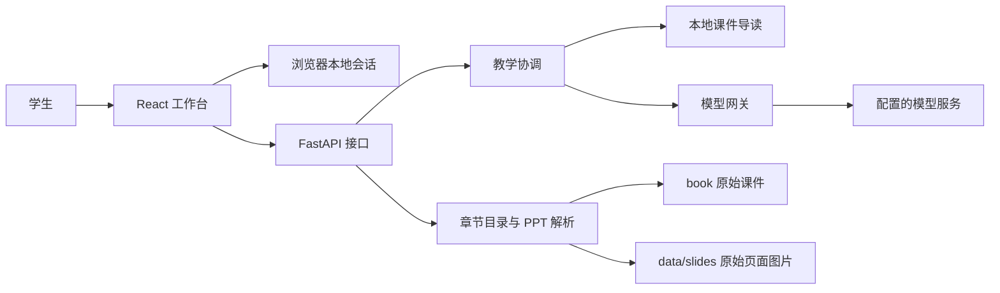

# 系统体系结构说明

## 目标与边界

章节伴学工作台将对话、讲义页码与教学图关联起来。主要部署场景是
学生个人电脑或答辩演示机。课程材料来自本地 book 目录；原始 PPT
不被修改。当前版本不建立 PDF 全书索引，也不提供用户上传入口。

## 容器与依赖

浏览器只能通过后端接触模型。密钥不写入前端、不进入浏览器本地存储。
前端开发服务器通过 /api 代理后端，避免浏览器跨域配置分散到各组件。

## 领域对象

- Chapter：一个本地 PPT 对应一个章节，稳定 ID 与真实文件绑定。
- Slide：1 起始的页码、标题、文本、备注，以及可选的原稿图片地址。
- Conversation：以 chapterId 为键的消息序列和当前位置。
- TeachingReply：讲解正文、来源页、下一展示页和可选图形。
- Diagram：有界的节点与边，不包含可执行 JavaScript 或 HTML。

## 主要流程

1. 前端查询章节列表并读取所选章节。
2. 从浏览器本地存储恢复该章节的消息和页码。
3. 学生发送问题，后端验证章节与页码。
4. 教学服务选择当前页与相关文字，构建有限上下文。
5. 无配置时执行明确标记的本地导读；有配置时请求模型并验证结果。
6. 前端追加消息、更新页码，用户按需打开课件或画布。
7. 会话持久化；切换章节不共享未完成请求的回复。

## 架构决策

### ADR-001：模块化单体优先

当前用户数和部署规模无需微服务。按目录分离课件、教学、模型调用和
UI 状态，减少网络故障点。将来多用户服务可以替换会话存储，但第一版
不为尚不存在的规模引入消息队列、服务发现或分布式事务。

### ADR-002：先章节内检索，不建立向量数据库

每章只有几十页，使用当前页与有限相关文本即可实现可验证的初版。
这不是完整语义检索。后续若加入 PDF 全书或大量课件，再以检索命中率
评测决定是否增加 embedding、混合检索及重排。

### ADR-003：教学文本与界面动作分离

接口返回结构化页码和图形。前端不解析任意文本中的隐藏执行指令，
也不执行模型生成代码。无效页码或不存在的节点必须被校验。

### ADR-004：优先真实课件，明确降级

离线转换将 PPT 导出为逐页图片。未转换时使用文字预览并提供原始文件。
图片预览不代表模型已经理解图中的所有语义；当前 AI 上下文以可提取
文本为主。后续可以增加 OCR/视觉模型，但必须保留来源并评测错误率。

## 质量属性场景

| 属性 | 场景 | 验收方式 |
| --- | --- | --- |
| 可修改性 | 更换模型服务 | 只改服务端环境配置，不改 UI |
| 可用性 | 未提供密钥 | 章节与页面仍可阅读，状态明确 |
| 可靠性 | 模型超时或返回非法 JSON | 显示错误，原会话可继续操作 |
| 可用性 | 刷新或切换章节 | 恢复本章消息和位置，不串章 |
| 安全性 | 资料包含提示注入文本 | 作为不可信资料，不授予工具权限 |
| 可维护性 | 代码增长 | 自动检查单文件不超过 500 行 |
| 可测试性 | 无外部模型网络 | 使用本地真实课件与模型响应测试替身 |

以上为设计与验收要求，不代表已进行生产压力测试或安全认证。

## 限制与后续

本地存储不提供账号同步或多人隔离；清理浏览器数据会丢失学习记录。
教学图是概念说明，不是具有完整故障/时序语义的仿真器。自测用于学习
反馈，不用作正式成绩。模型输出仍需对照原课件核查。
公网部署前需要认证、限流、访问审计、TLS、预算控制和隐私政策。
